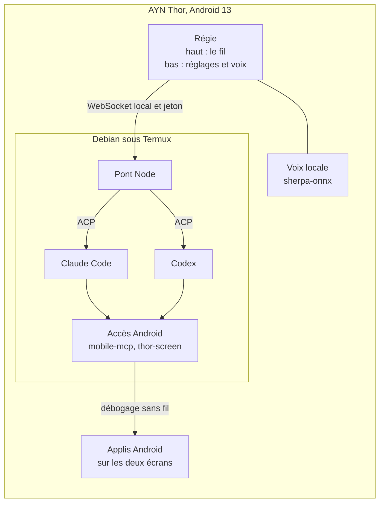

# Régie

**Régie fait de la console AYN Thor un poste de pilotage pour Claude Code et Codex : on parle à l’agent, on suit son travail sur l’écran du haut et on le règle sur l’écran du bas, à la manette.**

| Écran du haut : le fil de la session | Écran du bas : les réglages de l’agent |
| --- | --- |
|  |  |

*Captures de la Thor, 18 novembre 2026. Codex vient de répondre sur un projet d’essai ; en bas, sa réflexion passe à Medium, confirmée par l’agent.*

Claude Code et Codex tournent sur la console elle-même, dans une Debian sous Termux. Régie ne refait pas leur travail. Elle lance les sessions, montre ce que les agents produisent, relaie leurs demandes de validation et leur transmet ce que vous dites.

## Ce qu’on fait avec

- **Voir toutes ses sessions d’un coup d’œil.** L’accueil est une liste : agent, projet, branche, état, dernière action, ancienneté.
- **Suivre l’agent comme sur un ordinateur.** Le fil reprend ce que l’agent produit, tel quel : messages, commandes, sorties, modifications, demandes de validation. Régie n’y ajoute rien.
- **Lui parler.** Maintenir L2 et parler : la transcription s’écrit en bas, le haut ne bouge pas. Relâcher, relire, puis A envoie. La transcription est locale et gratuite par défaut ; ElevenLabs est une option. Rien n’est lu à voix haute.
- **Régler la session sur place.** En bas, la table des réglages de l’agent : mode de validation, modèle, réflexion, mode rapide et toute autre option qu’il expose. Une valeur ne compte comme appliquée qu’une fois confirmée par l’agent.
- **Valider à la manette.** Quatre modes : Plan d’abord, Modifications auto, Je valide chaque action, Tout autoriser. Une demande s’affiche dans le fil : A autorise, B refuse, L2 refuse en dictant une consigne.
- **Donner des ordres.** Maintenir R2 : « lance Codex sur un nouveau projet qui s’appelle météo », « mets tout en pause ». Les ordres qui agissent attendent A. « Où en est la session console » ouvre directement la session.
- **Relire les modifications.** X affiche les éditions de l’agent, ligne par ligne. L2 commente une ligne, Y demande une explication.
- **Laisser l’agent piloter la console.** Claude et Codex voient et commandent Android sur les deux écrans. « Ouvre le navigateur sur wikipedia.org » ouvre la page dans Chrome, en haut, sous vos yeux. Sur l’accueil, Y prépare une session « console » faite pour ça.
- **Lui parler depuis n’importe quelle appli.** Avec le mode console, L2 et R2 marchent même quand Chrome ou YouTube a la main. Si la conversation n’est visible nulle part, le message de l’agent passe en carte par-dessus l’écran du haut : L2 y répond, B la ferme.
- **Connecter ses comptes depuis la console.** Codex se connecte par code d’appareil : adresse, code et QR code s’affichent, à scanner avec un téléphone. Claude n’a pas de code d’appareil ; Régie indique la marche à suivre dans Termux.

| La liste des sessions | La dictée, sur l’écran du bas |
| --- | --- |
|  |  |
| **Codex ouvre Wikipédia dans Chrome, en haut** | **La connexion de Codex** (banc d’essai, code fictif) |
|  |  |

Régie démarre son pont à l’ouverture. En arrière-plan, les sessions continuent et l’écran du bas reste affiché. **Quitter** arrête le pont et les sessions. Rien ne démarre au boot de la console.

## Les commandes de la manette

| Touche | Action |
| --- | --- |
| L2 maintenu | Parler à la session : la transcription s’affiche en bas. Dans les modifications, commenter la ligne ; dans une validation, refuser en dictant une consigne. Avec le mode console, marche depuis toute appli. |
| R2 maintenu | Donner un ordre vocal. Les ordres qui agissent attendent A ; « où en est … » ouvre la session sans attendre. |
| A | Ouvrir, envoyer, appliquer. Dans une validation, autoriser une fois. |
| B | Revenir, effacer, fermer. Dans une validation, refuser. Sur l’accueil, ouvrir la connexion des agents. |
| X | Sur l’accueil, créer une session. Dans une session, voir les modifications. Dans une validation, autoriser pour la session, si l’agent le propose. En relecture, corriger un mot. |
| Y | Sur l’accueil, piloter la console. En relecture, compléter la dictée. Dans les modifications, demander une explication. |
| L1 / R1 | Session précédente ou suivante. Sur l’accueil, R1 ouvre d’abord une validation en attente. |
| Croix | Sur l’accueil, choisir une session. Dans une session, faire défiler le fil ; Droite passe les réglages en modification, Gauche revient à la fin du fil. |
| Stick droit | Faire défiler. |
| Start | Interrompre le tour en cours. Sur l’accueil, interrompre toutes les sessions occupées. |

L’écran du bas affiche toujours les touches utiles à l’instant. Il est tactile : les actions affichées s’y touchent aussi.

## Comment ça marche

- **L’app** Android, en Kotlin et Jetpack Compose, occupe les deux écrans et lit la manette. Elle démarre le pont dans Termux par l’intent `RUN_COMMAND` et lui parle par un WebSocket local, protégé par un jeton.
- **Le pont**, en Node et TypeScript, tourne dans la Debian. Il pilote les agents par l’[Agent Client Protocol](https://agentclientprotocol.com) (ACP), avec les adaptateurs publiés pour Claude Code et Codex, et garde l’historique des sessions.
- **Les agents** gardent leurs propres réglages, outils et comptes. Pour agir sur Android, ils passent par le débogage sans fil de la console.
- **La voix** est transcrite sur l’appareil par sherpa-onnx (modèle Parakeet). ElevenLabs peut la remplacer, avec votre clé.

## Installer

La [notice d’installation](docs/installation.md) part d’une Thor neuve : Termux, Debian, agents, pont, app, permissions et connexion des comptes. Il faut un Mac pour construire l’app et lancer les scripts par USB.

Matériel visé : AYN Thor sous Android 13, ARM64, écran du haut 1920 × 1080 non tactile, écran du bas 1240 × 1080 tactile. Un mode à un écran rassemble tout en haut quand celui du bas est éteint. Versions éprouvées : Claude Code 2.1.322, Codex 0.167.2, Node 24.22.3, mobile-mcp 1.0.17 ; les adaptateurs ACP sont figés par `bridge/package-lock.json`. Une autre version d’agent est signalée « non testée » sur l’accueil.

## Limites connues

- **Ce n’est pas une frontière de sécurité.** Les agents pilotent tout Android sans validation, Régie comprise : ils peuvent toucher ses boutons. Le sandbox de Codex est désactivé dans la Debian, et le mode Tout autoriser ne demande rien. Une consigne cachée dans une page ou un dépôt peut donc agir sur la console.
- **Un prototype personnel.** L’app s’installe en debug, avec ses scripts, sur une console préparée. Elle n’est sur aucun store.
- **L’installation complète n’a pas été rejouée sur une Thor neuve.** Chaque commande de la notice suit les scripts du dépôt, mais la séquence entière reste à valider de bout en bout.
- **Le mode console reste à éprouver sur la Thor.** L2 au-dessus d’une autre appli, la carte et la bulle sont couverts par des tests d’intégration ; leur essai sur la console, service d’accessibilité activé, reste à faire.
- **Claude se connecte dans Termux.** Son CLI n’offre pas de code d’appareil. Un changement de compte demande de quitter Régie avant.
- **La voix locale bute sur les noms techniques** et transcrit parfois le bruit ambiant. Rien ne part sans A. Les essais ont surtout utilisé des voix de synthèse rejouées.
- **Les modifications affichées sont celles que l’agent expose**, pas un `git diff` complet : une écriture par commande shell peut manquer.
- **Start interrompt le tour**, sans garantir l’arrêt de tous ses sous-processus.
- **Android peut tuer Termux.** Les réglages de la notice limitent ce risque ; une mise à jour système peut les annuler.
- **Les agents évoluent vite.** Une option ou une information qu’un agent n’expose pas est annoncée comme non communiquée, jamais inventée.

## Développer

La [documentation de développement](docs/developpement.md) décrit l’architecture, les tests, le banc d’essai sur émulateur et la façon de travailler. Le [PRD](docs/PRD.md) fixe le produit, les [ADR](docs/adr/README.md) les décisions techniques, et le [protocole du pont](docs/protocole-pont.md) le contrat entre l’app et le pont.
