<p align="center">
  
</p>

<h1 align="center">ThorAI</h1>

<p align="center">
  <strong>Vos agents de code habitent un hameau en pixel art.<br>
  Vous le parcourez à la manette, vous leur parlez à la voix.</strong>
</p>

<p align="center">
  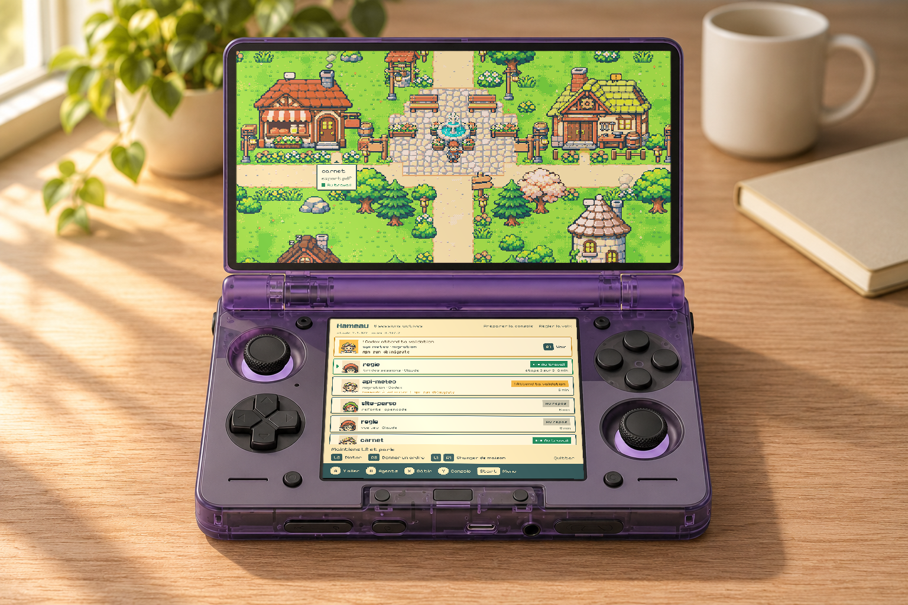
</p>

ThorAI fait de la console **AYN Thor** un poste de pilotage pour **Claude Code**, **Codex** et **opencode**. Les agents tournent sur la console elle-même, dans une Debian sous Termux. ThorAI ne refait pas leur travail : elle lance les sessions, montre leur avancement sur les deux écrans, relaie leurs demandes de validation et leur transmet ce que vous dites.

Chaque session est une maison. Son habitant est l’agent qui y travaille. Vous êtes le coursier qui passe de porte en porte.

## Ce que ça change

- **Plus de terminal sur une console.** On ne tape plus : on parle, on relit, A envoie.
- **Toutes les sessions d’un coup d’œil.** Chaque maison montre l’état de sa session, de loin.
- **Aucune validation manquée.** Un oiseau apporte le courrier, et R1 mène tout droit au parchemin.
- **L’agent reste l’agent.** Ses outils, ses consignes, ses réglages et ses comptes restent les siens. ThorAI montre ce qu’il expose, tel quel. Ce qu’il ne dit pas est annoncé « non communiqué », jamais inventé.
- **Local et gratuit par défaut.** La transcription tourne sur la console, hors ligne. ElevenLabs est une option.
- **Une app qu’on lance, rien de plus.** Rien ne démarre au boot. Fermer le jeu laisse tourner les sessions ; « Quitter » arrête le pont et les sessions.

## Visite du hameau

### Le hameau : un projet par rue, une maison par session

Au lancement, l’écran titre montre le hameau au lever du soleil. Puis on y entre.

- Le coursier marche à la croix ou au stick gauche. A entre dans la maison devant lui, ou l’y emmène. L1 et R1 passent d’une maison à l’autre.
- Une bulle sur chaque toit dit où en est la session : des points au travail, un « ! » ambre qui sautille quand elle attend votre validation, un « z » au repos, un « ! » rouge en cas d’échec. Les fenêtres s’allument, la cheminée fume.
- Devant une porte, un panneau donne le projet, la session et son état.
- En bas, le carnet liste les sessions : projet, session, agent, état, étape et ancienneté. La première validation en attente est en tête.
- Le hameau grandit avec vos projets. Une nouvelle session prend un terrain libre de sa rue, une rue pleine s’allonge, un nouveau projet ouvre une nouvelle rue.

| L’écran titre | Le hameau |
| --- | --- |
| 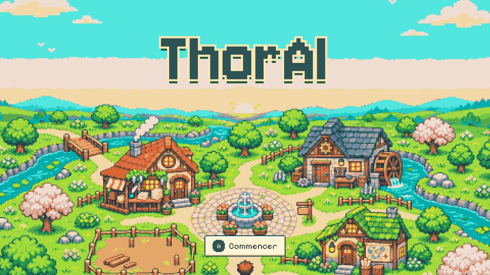 | 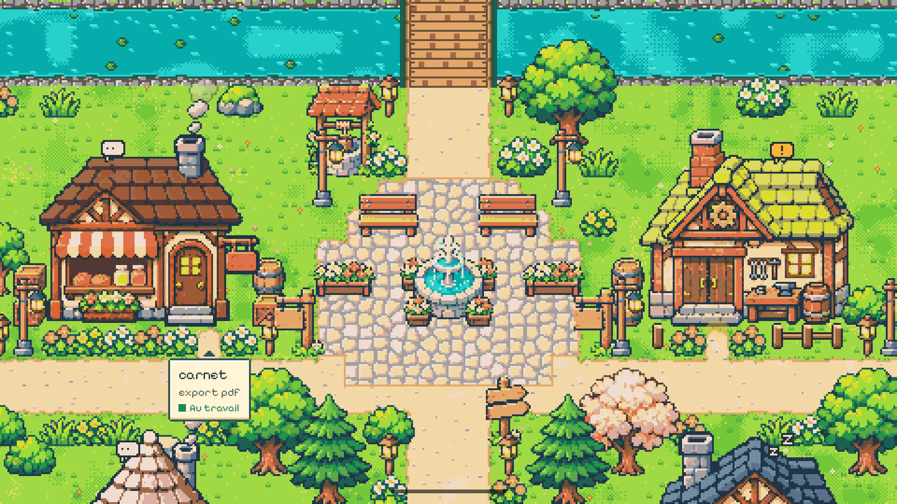 |

### Dans une maison : l’habitant au travail

L’habitant, c’est l’agent : **le scribe** pour Claude, **le bricoleur** pour Codex, **la cartographe** pour opencode.

- En haut, il travaille à son bureau. Une bulle dit ce qu’il fait (« Modifie Overview.kt »), sa dernière réplique s’écrit dans une boîte de dialogue, et son plan se coche à côté, avec les fichiers modifiés.
- En bas, le fil brut de la session : messages, commandes, sorties, modifications. ThorAI n’y ajoute ni point ni bilan.
- Sous le fil, les réglages de l’agent : mode, modèle, réflexion, mode rapide, et toute autre option qu’il expose. Droite les passe en modification, A applique. Une valeur ne compte comme appliquée qu’une fois confirmée par l’agent.
- Start interrompt l’agent.

| L’habitant à son bureau | Le fil et les réglages |
| --- | --- |
| 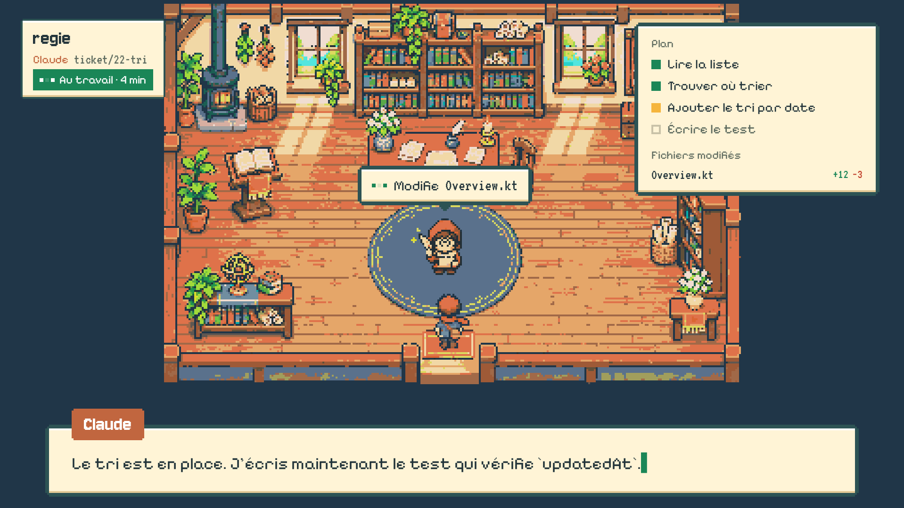 | 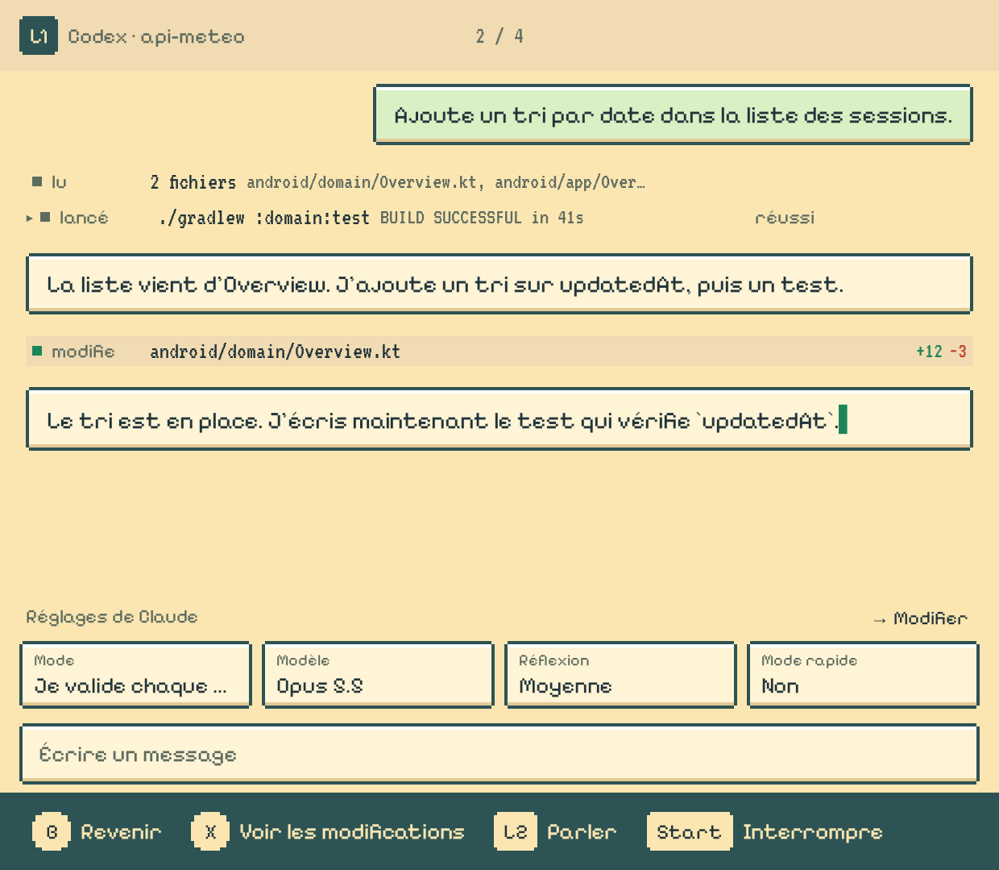 |

### Parler à l’agent : L2

Maintenez L2 et parlez. Le coursier prend la parole, la transcription s’écrit en bas, et l’écran du haut ne bouge pas. Les noms du dépôt reconnus sont surlignés.

Relâchez, relisez : A envoie, B efface, X corrige un mot, Y complète. **Rien ne part sans A.** Rien n’est lu à voix haute : tout se lit à l’écran.

| Le coursier parle | La dictée, à relire |
| --- | --- |
| 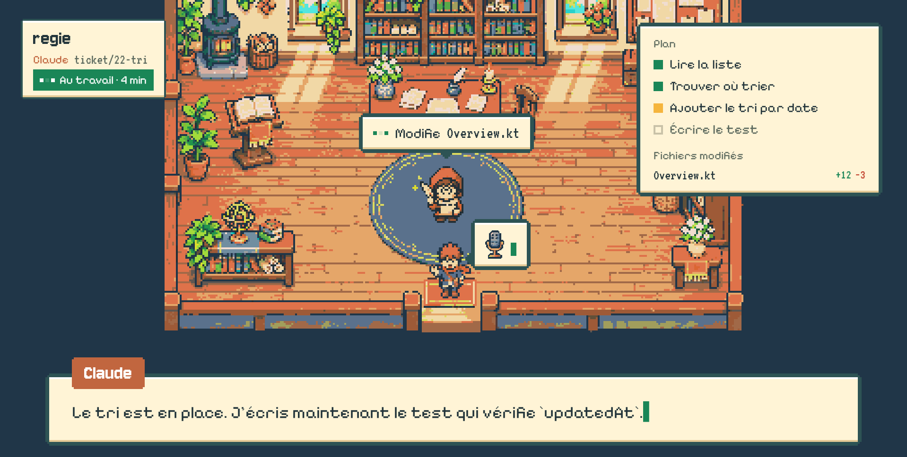 | 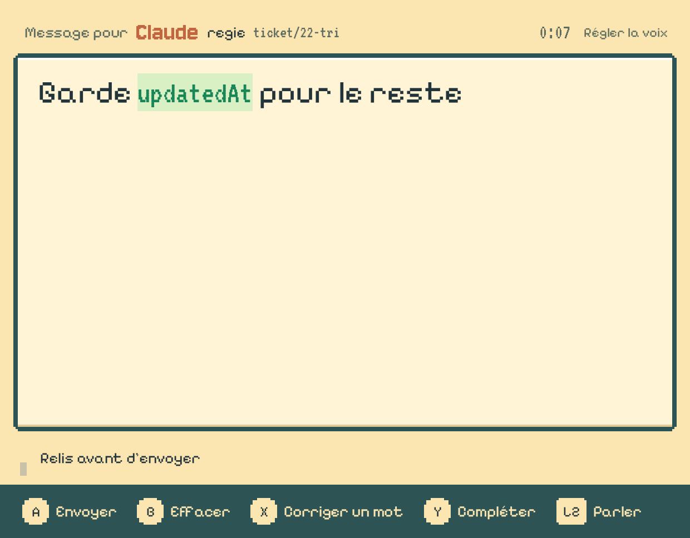 |

### Le parchemin : valider à la manette

Quand l’agent demande la permission, l’habitant vous tend un parchemin. La commande ou le fichier y est en clair, avec la raison et ce que ça touche.

En bas, un menu de choix : **A** autorise une fois, **B** refuse, **X** autorise pour la session si l’agent le propose, **L2** refuse en dictant une consigne. Quatre modes règlent ce qui est demandé : Plan d’abord, Modifications auto, Je valide chaque action, Tout autoriser.

| L’habitant tend sa demande | Le menu de choix |
| --- | --- |
|  | 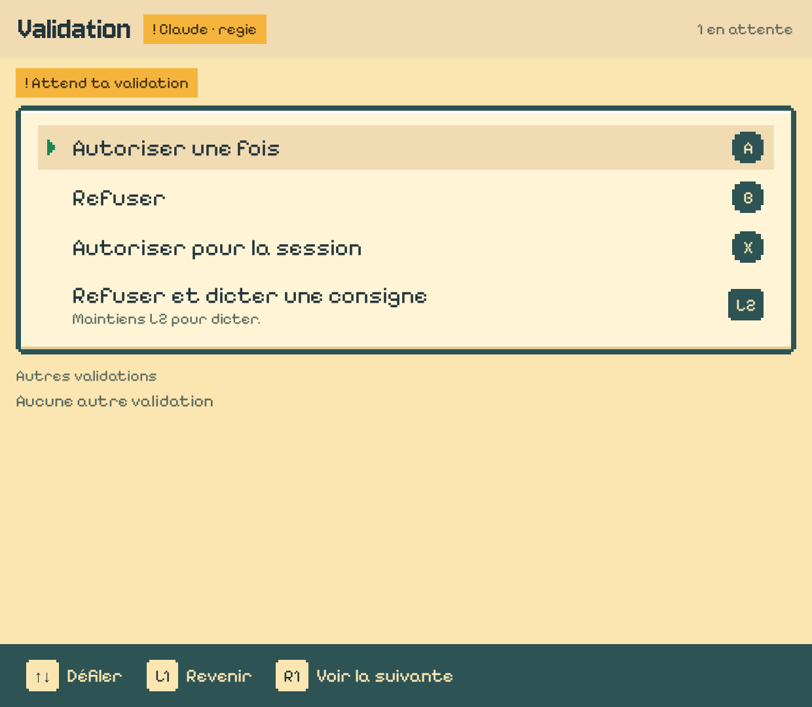 |

### Le tableau de liège : relire les modifications

Dans une maison, X épingle les modifications de l’agent sur un tableau de liège, une feuille par fichier. La croix parcourt les lignes. L2 commente la ligne choisie à la voix, Y demande une explication du bloc.

| La feuille épinglée | Les fichiers et les gestes |
| --- | --- |
| 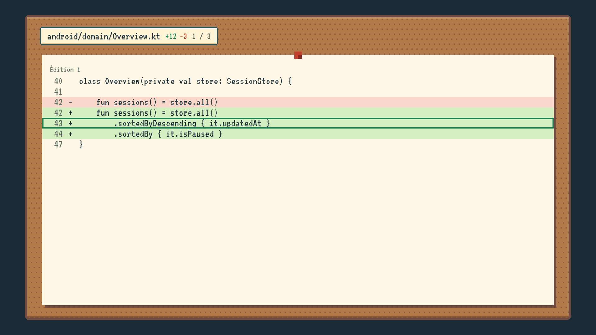 | 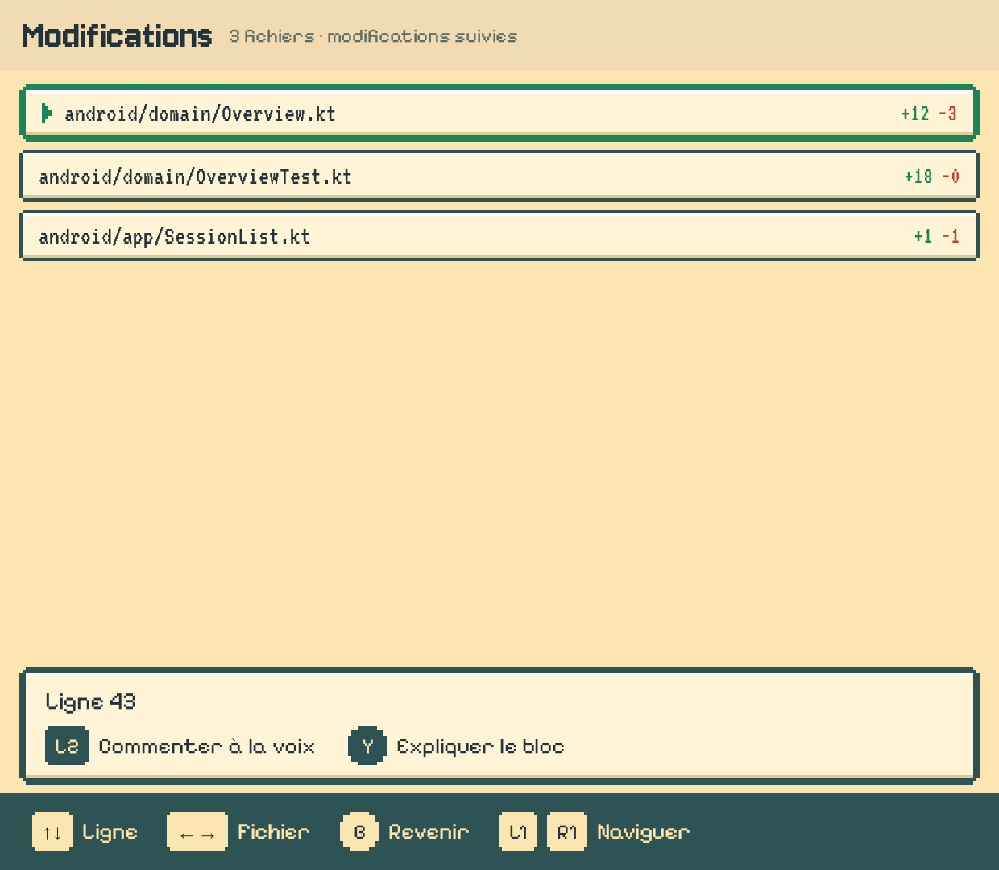 |

### Bâtir : une nouvelle session

Sur le hameau, X ouvre la fiche d’une nouvelle session : agent, projet, branche, mode, modèle, réflexion et consigne. Un ordre vocal la remplit pour vous. « Nouveau projet » crée un dépôt Git vide, et sa rue avec.

A bâtit. Le chantier suit la création en quatre étapes : la fiche, la session créée, l’agent lancé, la première réponse. La maison finie, le coursier y entre.

| Le chantier | La fiche, remplie depuis un ordre vocal |
| --- | --- |
| 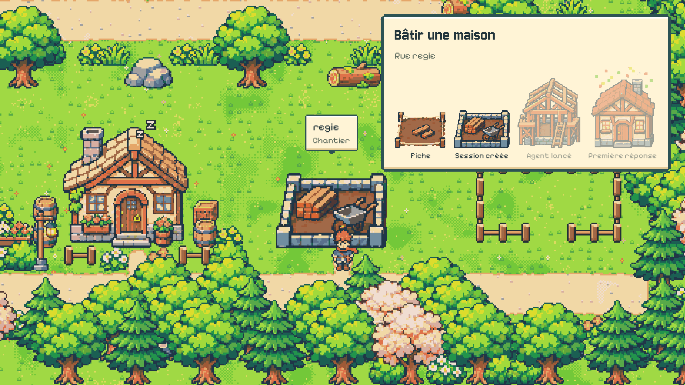 | 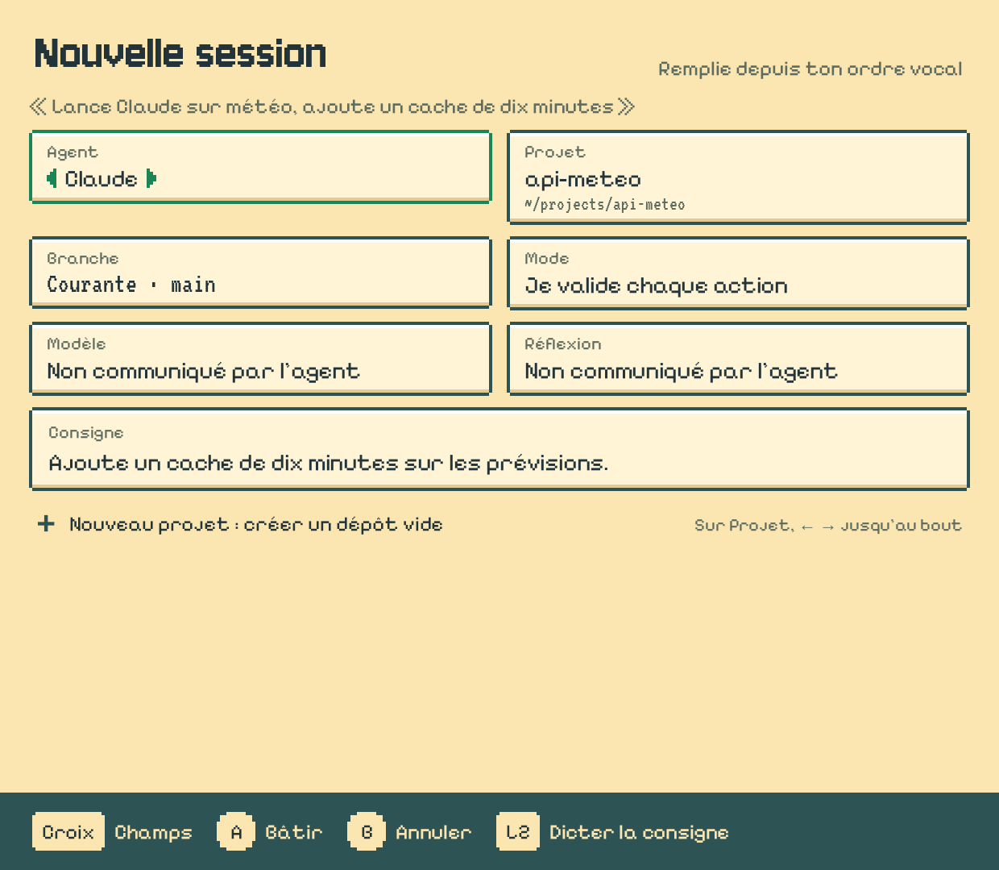 |

### Les ordres vocaux : R2

Maintenez R2 et dites ce que vous voulez : « lance Claude sur météo », « où en est Codex ? », « approuve », « mets tout en pause ». Les ordres courants se reconnaissent sur la console. Les ordres qui agissent attendent A. « Où en est … » ouvre la maison sans attendre.

Pour les phrases ambiguës, Mistral peut aider, avec votre clé : facultatif et payant.

### Le menu Start, le courrier et l’oiseau messager

Quand un agent a besoin de vous, un oiseau messager apporte une lettre en haut de l’écran : une validation, une question, une fin ou un échec de session. R1 vous y emmène. Les lettres restent ensuite dans le courrier.

Start ouvre le menu de pause : Courrier, Agents, Réglages, Préparer la console, Tout mettre en pause, Quitter.

| L’oiseau messager | Le menu de pause et le courrier |
| --- | --- |
| 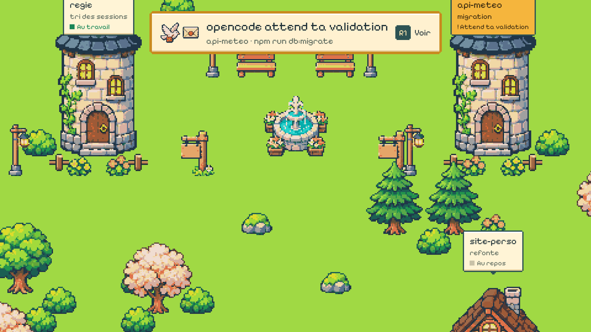 | 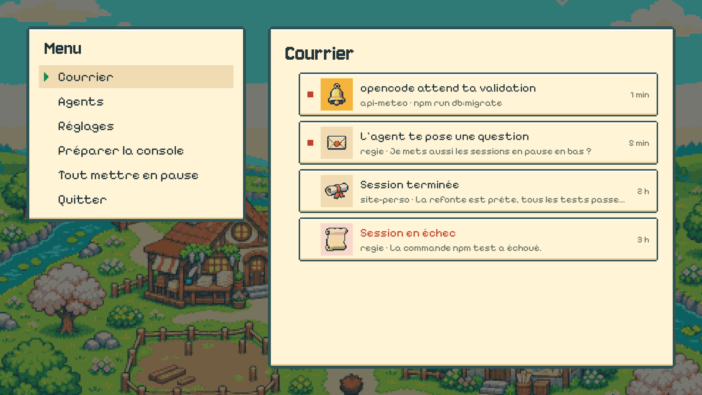 |

### La tour : l’agent pilote la console

Claude, Codex et opencode voient et commandent Android, sur les deux écrans. Dites « ouvre le navigateur sur wikipedia.org » : Chrome s’ouvre en haut, sous vos yeux. Sur le hameau, Y mène à la tour, la session faite pour ça.

Avec le **mode console**, L2 et R2 marchent même quand une autre appli occupe l’écran du haut. En bas, la tour suit la session. Si l’agent vous écrit, sa réponse passe en carte volante par-dessus l’autre appli : L2 répond, B ferme.

| La tour, en bas | La carte volante, par-dessus une autre appli |
| --- | --- |
| 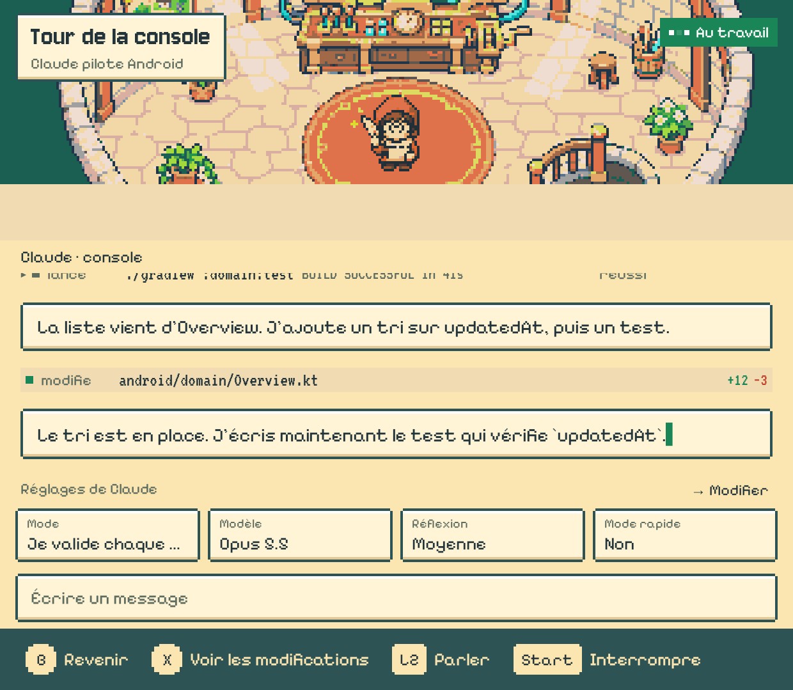 | 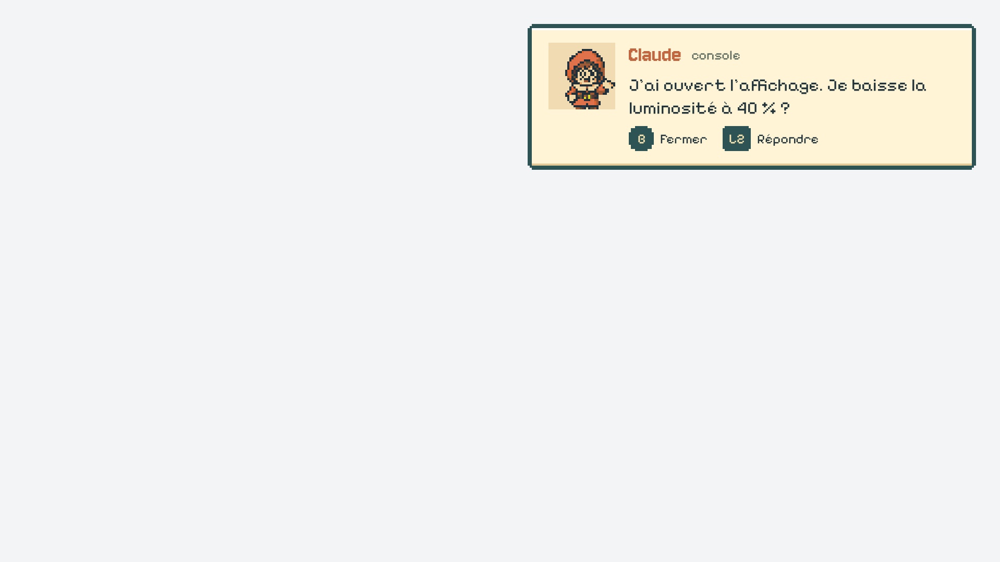 |

### Les agents et leurs comptes

Sur le hameau, B ouvre les agents. On s’y connecte depuis la console :

- **Codex**, par code d’appareil : l’adresse, le code et un QR code s’affichent, à scanner avec un téléphone ;
- **Claude**, sans code d’appareil : ThorAI donne la marche à suivre dans Termux ;
- **opencode**, avec une clé OpenCode Go saisie dans un champ masqué.

Chaque compte reste dans les fichiers de l’agent, sur la console. ThorAI ne le garde pas.

### Préparer la console

Au premier lancement, le coursier suit une route jalonnée de neuf panneaux, un par étape : Termux et Debian, le pont, la voix, les notifications, puis le mode console, l’accès à Android et les comptes, facultatifs.

Chaque étape se vérifie seule sur la console et passe au vert. ThorAI ouvre le bon écran d’Android ou copie les commandes pour Termux, mais n’accorde jamais rien à votre place. Start › Préparer la console reprend le parcours plus tard.

| La route d’arrivée | Une étape et ses commandes |
| --- | --- |
|  | 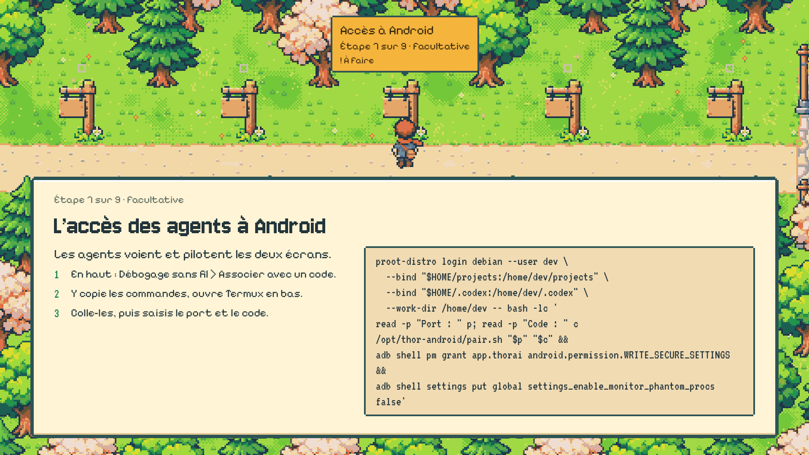 |

## Les commandes de la manette

| Touche | Action |
| --- | --- |
| Croix, stick gauche | Sur le hameau, faire marcher le coursier. Dans les menus, choisir. Dans une session, faire défiler le fil ; Droite passe les réglages en modification, Gauche revient à la fin du fil. |
| A | Entrer, envoyer, appliquer. Sur le hameau, entrer dans la maison devant le coursier, sinon y aller. Dans une validation, autoriser une fois. |
| B | Revenir, effacer, fermer. Dans une validation, refuser. Sur le hameau, ouvrir les agents. Un clavier ouvert se ferme d’abord. |
| X | Sur le hameau, bâtir une maison. Dans une maison, voir les modifications. Dans une validation, autoriser pour la session. En relecture, corriger un mot. |
| Y | Sur le hameau, aller à la tour (mode console). En relecture, compléter la dictée. Dans les modifications, demander une explication. |
| L1 / R1 | Maison précédente ou suivante. R1 mène d’abord à une validation en attente. |
| L2 maintenu | Parler à l’agent. Dans les modifications, commenter la ligne ; dans une validation, refuser en dictant. Avec le mode console, depuis toute appli. |
| R2 maintenu | Donner un ordre vocal. |
| Stick droit | Faire défiler. |
| Start | Sur le hameau, ouvrir le menu de pause. Dans une maison, interrompre l’agent. |

L’écran du bas affiche toujours les touches utiles à l’instant. Il est tactile : ce qui s’y affiche se touche aussi. Quand l’écran du bas est éteint, tout se rassemble en haut.

## Comment ça marche

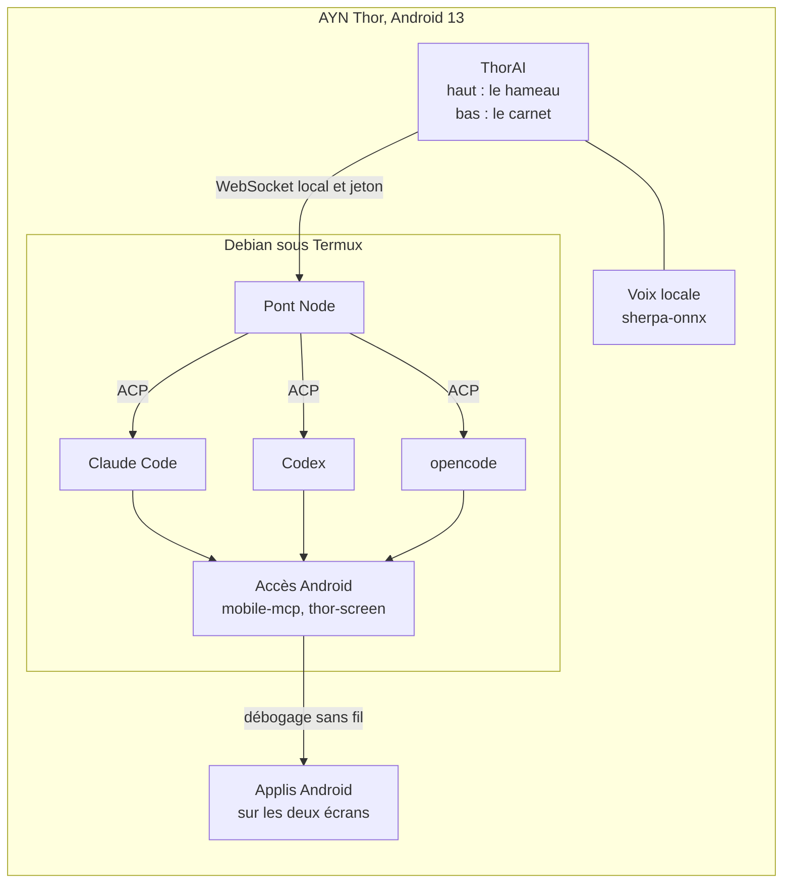

- **L’app**, en Kotlin et Jetpack Compose, occupe les deux écrans et lit la manette. Le hameau est dessiné au pixel sur un Canvas Compose, agrandi quatre fois ([ADR 24](docs/adr/24-vue-jeu.md)). L’app démarre le pont dans Termux et lui parle par un WebSocket local, protégé par un jeton propre à l’app.
- **Le pont**, en Node et TypeScript, tourne dans la Debian. Il pilote les agents par l’[Agent Client Protocol](https://agentclientprotocol.com) (ACP) et garde l’historique des sessions.
- **Les agents** gardent leurs propres réglages, outils et comptes. Pour agir sur Android, ils passent par le débogage sans fil de la console.
- **La voix** est transcrite sur l’appareil par sherpa-onnx (modèle Parakeet). ElevenLabs peut la remplacer, avec votre clé.

## Installer

En bref, sur la console :

1. Installer Termux depuis ses [releases GitHub](https://github.com/termux/termux-app/releases).
2. Dans Termux, préparer la Debian, les agents et le pont :

   ```sh
   pkg update && pkg install git
   git clone https://github.com/DabiK/thorai.git
   cd thorai && bash thor/install-on-device.sh
   ```

3. Installer l’APK signé des [releases de ThorAI](https://github.com/DabiK/thorai/releases).
4. Ouvrir ThorAI : la route « Préparer la console » guide la suite.

La [notice d’installation](docs/installation.md) détaille chaque étape, le parcours depuis un Mac par USB, le dépannage et la [mise à jour depuis l’ancienne ThorAI](docs/installation.md#mettre-à-jour-depuis-lancienne-thorai).

Matériel visé : AYN Thor sous Android 13, ARM64, écran du haut 1920 × 1080 non tactile, écran du bas 1240 × 1080 tactile. Versions éprouvées : Claude Code 2.1.322, Codex 0.167.2, opencode 2.1.2, Node 24.22.3, mobile-mcp 1.0.17 ; les adaptateurs ACP sont figés par `bridge/package-lock.json`. Une autre version d’agent est signalée « version non testée » dans le carnet.

## Limites connues

- **Ce n’est pas une frontière de sécurité.** Les agents pilotent tout Android sans validation, ThorAI comprise : ils peuvent toucher ses boutons. Le sandbox de Codex est désactivé dans la Debian, et le mode Tout autoriser ne demande rien. Une consigne cachée dans une page ou un dépôt peut donc agir sur la console.
- **Une installation manuelle.** L’APK signé s’installe depuis une release GitHub, après préparation de Termux et de la Debian. L’app n’est sur aucun store.
- **L’installation complète n’a pas été rejouée sur une Thor neuve.** Chaque commande de la notice suit les scripts du dépôt, mais la séquence entière reste à valider de bout en bout.
- **Le mode console reste à éprouver en entier sur la Thor.** La carte volante et la bulle sont couvertes par des tests ; leur essai sur la console, service d’accessibilité activé, reste à faire.
- **Claude se connecte dans Termux.** Son CLI n’offre pas de code d’appareil. Un changement de compte demande de quitter ThorAI avant.
- **La voix locale bute sur les noms techniques** et transcrit parfois le bruit ambiant. Rien ne part sans A.
- **Les modifications affichées sont celles que l’agent expose**, pas un `git diff` complet : une écriture par commande shell peut manquer.
- **Start interrompt l’agent**, sans garantir l’arrêt de tous ses sous-processus.
- **La taille du texte d’Android est ignorée.** Le texte pixel suit la grille du jeu, réglée pour les écrans de la Thor.
- **Android peut tuer Termux.** Les réglages de la notice limitent ce risque ; une mise à jour système peut les annuler.
- **Les agents évoluent vite.** Une option qu’un agent n’expose pas est annoncée comme non communiquée, jamais inventée.

## Développer

| Dossier | Contenu |
| --- | --- |
| `android/` | L’app : `domain` (Kotlin pur, modèle, ports, cas d’usage), `game/engine` (le moteur du jeu, Kotlin pur), `game/ui` (rendu pixel, kit et écrans), `gateway-bridge` (passerelle vers le pont), `app` (seule racine de composition) |
| `voice/` | La voix, build Gradle séparé : ports en Kotlin pur, voix locale, ElevenLabs, voix factice |
| `bridge/` | Le pont Node/TypeScript, qui pilote les agents par ACP |
| `thor/` | Les scripts poussés sur la console : installeur Termux, pont, accès des agents à Android, opencode |
| `scripts/` | Déploiement, release et captures depuis le Mac |

Portes de qualité :

- `./gradlew check` dans `android/` et dans `voice/` ;
- `npm run check` dans `bridge/`.

Pour aller plus loin :

- la [documentation de développement](docs/developpement.md) : architecture hexagonale, tests, banc d’essai, captures ;
- le [PRD](docs/PRD.md), qui fixe le produit ;
- les [ADR](docs/adr/README.md), dont la [vue jeu](docs/adr/24-vue-jeu.md) ;
- la [direction artistique « Aube »](docs/rebrand/da-jeu.md) ;
- le [protocole du pont](docs/protocole-pont.md) et la [fiche de la console](docs/thor.md).

ThorAI s’appelait Régie : ce nom de code reste dans le dépôt, les paquets Kotlin et les scripts.

## Crédits et licences

- **Code** : [MIT](LICENSE), © 2026 DabiK. Les dépendances gardent leurs licences respectives.
- **Polices** : Jersey 10, Pixelify Sans et VT323, de Google Fonts, sous SIL Open Font License 1.1. Le `OFL.txt` de chaque police est dans `android/game/ui/src/main/assets/licences/`.
- **Images du jeu** : décors, personnages, maisons et fonds ont été générés pour ce projet avec Codex (`image_gen`), puis ramenés sur une palette de 32 couleurs. Ils sont produits par l’auteur du projet, sous réserve des conditions d’utilisation d’OpenAI. Le sol, les clôtures, les bulles, le curseur et les touches sont dessinés par le code.
- **Aucun asset tiers** : ni Kenney, ni OpenGameArt, ni ressource CC0. L’univers, les personnages, les tuiles et l’interface sont originaux. Sources et fabrication : [direction artistique](docs/rebrand/da-jeu.md#sources-et-licences).
- **Captures** : prises par les tests Robolectric, aux tailles des écrans de la Thor, avec des données de démonstration.
- **Image d’en-tête** : la console est une photo générée avec Codex (`image_gen`), d’après une photo de la vraie AYN Thor. Ses écrans montrent les vraies captures, incrustées ensuite. Consigne et image brute : `docs/rebrand/assets/aube/readme/`.
