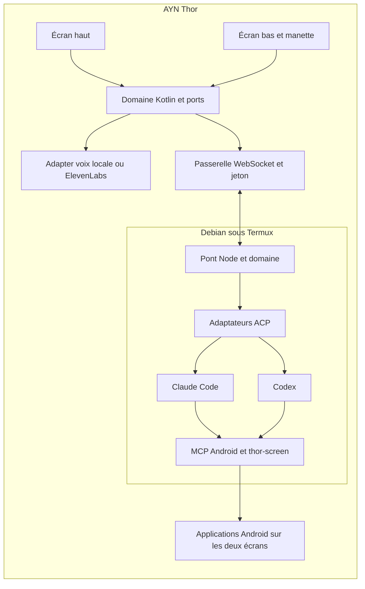

# Régie

**Régie transforme l’AYN Thor en poste de pilotage à la voix et à la manette pour Claude Code et Codex, avec le travail en haut et les commandes en bas.**

| Écran du haut : suivre la session | Écran du bas : parler et agir |
| --- | --- |
|  |  |

Captures réelles du banc à deux écrans, le 14 novembre 2026 : Codex travaille sur `regie-demo`, un projet de démonstration. Le pont tourne sur le Mac pour cet essai ; sur la Thor, il tourne dans sa Debian.

## Ce qu’on fait avec

- **Suivre plusieurs sessions** : avancement, fil en direct, plan quand l’agent en fournit un, fichiers modifiés, points écrits et notifications.
- **Parler à l’agent** : maintenir L2, relire la transcription, corriger ou compléter, puis envoyer avec A. La transcription est **locale par défaut** ; aucun texte n’est lu à voix haute.
- **Donner un ordre** : maintenir R2, dire par exemple « ouvre cette session » ou « mets tout en pause », puis confirmer. Les règles courantes marchent sans clé de modèle distant.
- **Choisir les validations** : Plan d’abord, Modifs auto, Je valide chaque action ou Tout autoriser. Une demande se lit dans le fil ; A autorise une fois, B refuse, X autorise pour la session quand l’agent le permet. Les lectures reconnues sont automatiques.
- **Relire un diff** : parcourir les éditions exposées par l’agent, commenter une ligne avec L2 ou demander une explication écrite avec Y puis A.
- **Lancer un nouveau projet** : X depuis la régie, ou « lance Codex sur un nouveau projet qui s’appelle météo ». La fiche permet de choisir agent, projet, modèle, réflexion, validation et consigne. Régie crée le dépôt vide ; les changements de branche sont confiés à l’agent.
- **Piloter Android depuis les agents** : leurs outils MCP et `thor-screen` voient et commandent les deux écrans, Régie comprise, sans validation supplémentaire.

Régie démarre son pont à l’ouverture. Passer en arrière-plan laisse les sessions tourner et le tableau de bord du bas visible. **Quitter** arrête le pont et ses sessions. Rien ne démarre au boot.

## Matériel et état du projet

La cible est l’**AYN Thor sous Android 13**, ARM64 : écran haut 1920 × 1080, écran bas tactile 1240 × 1080, manette intégrée. Un mode à un écran rassemble le contenu et les commandes. Voir la [fiche matérielle](docs/thor.md).

C’est un prototype personnel installable en **debug**, pas une application distribuée sur un store. Il réutilise les comptes des CLI ; les fournisseurs de voix et d’ordres cloud sont facultatifs. Les versions éprouvées sont Claude Code **2.1.322**, Codex **0.167.2** et Node **24.22.3**. Les adaptateurs ACP sont figés par `bridge/package-lock.json`. Une autre version peut fonctionner mais est signalée comme non testée.

## Installer sur la Thor

Les étapes 1 à 3 préparent une **nouvelle installation**. Si Termux, Debian et les agents sont déjà configurés, vérifier les chemins puis passer à l’étape 4. La procédure complète sur une console vierge reste à rejouer ; les scripts de déploiement ont été utilisés sur la Thor existante. Les commandes mentionnent explicitement leur terminal.

### 1. Termux et accès USB

Sur la console, installer **Termux depuis les releases GitHub officielles, variante debug** : nos scripts utilisent `run-as com.termux`. La version relevée est 0.118.3. Ne pas mélanger les signatures des différentes distributions de Termux et de ses extensions. Termux:Boot n’est pas nécessaire. [Installation officielle de Termux](https://github.com/termux/termux-app#installation).

Dans les options développeur d’Android, activer le débogage USB, brancher le Mac et accepter sa clé sur la console. Depuis le Mac :

```sh
adb devices
export THOR_SERIAL=THOR0000000001  # remplacer par la série affichée pour une autre Thor
adb -s "$THOR_SERIAL" shell run-as com.termux id
```

La dernière commande doit réussir. Si Android répond « package not debuggable », cette installation de Termux n’est pas compatible avec les scripts livrés. Exempter Termux de l’économie de batterie dans ses paramètres Android. La configuration de référence désactive aussi le moniteur de processus fantômes :

```sh
adb -s "$THOR_SERIAL" shell settings put global settings_enable_monitor_phantom_procs false
```

Dans **Termux** :

```sh
pkg update
pkg upgrade
pkg install proot-distro nodejs-lts tmux git
mkdir -p ~/projects ~/.codex ~/bin
proot-distro install debian:13 --name debian
proot-distro login debian
```

Le conteneur doit s’appeler `debian`. Les scripts attendent le rootfs sous `$PREFIX/var/lib/proot-distro/containers/debian/rootfs`. Vérifier ce chemin si la version de PRoot Distro diffère. [Installation et options de PRoot Distro](https://github.com/termux/proot-distro#readme).

### 2. Debian, Node et Codex

Dans **Debian, en root** (le terminal ouvert ci-dessus), pour cette première installation :

```sh
apt-get update
apt-get install -y ca-certificates curl xz-utils git jq procps python3 ripgrep
useradd --create-home --shell /bin/bash dev
mkdir -p /home/dev/projects /home/dev/.codex
chown -R dev:dev /home/dev
cd /tmp
curl -fLO https://nodejs.org/dist/v24.22.3/node-v24.22.3-linux-arm64.tar.xz
curl -fLO https://nodejs.org/dist/v24.22.3/SHASUMS256.txt
grep ' node-v24.22.3-linux-arm64.tar.xz$' SHASUMS256.txt | sha256sum -c -
tar -xJf node-v24.22.3-linux-arm64.tar.xz -C /opt
ln -s /opt/node-v24.22.3-linux-arm64/bin/node /usr/local/bin/node
ln -s /opt/node-v24.22.3-linux-arm64/bin/npm /usr/local/bin/npm
ln -s /opt/node-v24.22.3-linux-arm64/bin/npx /usr/local/bin/npx
npm install --global --prefix /opt/codex-cli @openai/codex@0.167.2
ln -s /opt/codex-cli/bin/codex /usr/local/bin/codex
node --version
codex --version
exit
```

Ne poursuivre l’extraction que si la vérification SHA-256 répond `OK`. Node et Codex sont installés **dans Debian**, même si Node existe aussi côté Termux. [Installation officielle de Codex](https://github.com/openai/codex#readme).

### 3. Utilisateur dev, Claude Code et connexion aux comptes

De retour dans **Termux**, ouvrir Debian avec les mêmes montages que le pont :

```sh
proot-distro login debian --user dev \
  --bind "$HOME/projects:/home/dev/projects" \
  --bind "$HOME/.codex:/home/dev/.codex" \
  --work-dir /home/dev -- bash -l
```

Dans **Debian, en dev** :

```sh
curl -fsSL https://claude.ai/install.sh -o /tmp/claude-install.sh
bash /tmp/claude-install.sh 2.1.322
mkdir -p ~/.local/bin
printf '\nexport PATH="$HOME/.local/bin:/usr/local/bin:$PATH"\n' >> ~/.profile
export PATH="$HOME/.local/bin:/usr/local/bin:$PATH"
claude --version
claude
# Suivre la connexion affichée, puis quitter le CLI.
codex login --device-auth
```

Faire la connexion dans le navigateur indiqué, avec ses propres comptes. Le login par code de Codex doit être autorisé dans les paramètres du compte. Les connexions restent dans les dossiers privés des agents, jamais dans ce dépôt. [Installation Claude](https://code.claude.com/docs/en/setup), [authentification Codex](https://developers.openai.com/codex/auth/).

Dans `~/.codex/config.toml` de **dev**, ajouter ou ajuster ces deux clés à la racine du fichier, avant les sections `[nom]`, sans écraser les autres réglages :

```toml
sandbox_mode = "danger-full-access"
approval_policy = "on-request"
```

C’est le contournement PRoot de la configuration Thor : le sandbox Linux ne fonctionne pas dans cette Debian. Les niveaux choisis dans Régie sont ensuite appliqués à chaque session. Les gestes Android sont autorisés sans confirmation par choix du projet. Les [décisions du pont](docs/adr/02-pilotage-des-agents.md) détaillent cette limite. Quitter Debian avec `exit` avant la suite.

### 4. Construire l’app et déployer le pont

Sur le **Mac**, obtenir ce dépôt avec son accès Git habituel :

```sh
git clone git@github.com:DabiK/regie.git
cd regie
```

Le dépôt est privé : cet accès doit déjà être autorisé. Installer JDK 25 (ou 21), Node 24+, Android SDK avec la plateforme 36, les build-tools et platform-tools. `adb` doit être dans le PATH. Depuis la racine du dépôt :

```sh
export ANDROID_HOME=/opt/homebrew/share/android-commandlinetools  # adapter à son SDK
printf 'sdk.dir=%s\n' "$ANDROID_HOME" > android/local.properties
printf 'sdk.dir=%s\n' "$ANDROID_HOME" > voice/local.properties
(cd bridge && npm ci && npm run check)
(cd android && ./gradlew check)
(cd voice && ./gradlew check)
scripts/thor-install.sh
thor/bridge/install.sh
thor/computer-use/install.sh
```

`thor-install.sh` installe uniquement `app.regie`. Le pont est copié dans `/home/dev/.local/share/regie/bridge`, son jeton aléatoire est créé puis copié directement dans le stockage privé de l’app. Le déploiement active `allow-external-apps=true` dans Termux. L’installation computer-use ajoute les MCP, consignes et permissions Android aux configurations natives des deux agents ; les autres entrées sont conservées.

Si l’app a été installée après le pont, recopier seulement son jeton :

```sh
thor/bridge/install.sh token-app
```

### 5. Associer Android à sa Debian

La console doit être connectée au Wi-Fi. Dans **Paramètres → Options pour les développeurs → Débogage sans fil**, activer le débogage et autoriser ce réseau. Ouvrir **Associer l’appareil avec un code d’association** et garder la fenêtre ouverte.

Sur le **Mac**, saisir le port et le code actuellement affichés (ils expirent) :

```sh
read -r -p 'Port d’association : ' REGIE_PAIR_PORT
read -r -s -p 'Code d’association : ' REGIE_PAIR_CODE
thor/computer-use/pair-from-mac.sh "$REGIE_PAIR_PORT" "$REGIE_PAIR_CODE"
unset REGIE_PAIR_CODE REGIE_PAIR_PORT
```

Exécuter ce bloc dans **bash** (`bash` depuis le terminal du Mac si nécessaire). Le script doit répondre `THOR_ANDROID=ok`. Il associe la clé de la **Debian**, pour fonctionner ensuite sans le Mac. Le port d’association est distinct du port de connexion ; ne pas utiliser `adb pair` sur le Mac à la place. Détails et dépannage : [accès Android](thor/computer-use/README.md).

### 6. Permissions et premier lancement

Sur le Mac, accorder une fois la permission permettant à Régie de rallumer le débogage sans fil à son ouverture :

```sh
adb -s "$THOR_SERIAL" shell pm grant app.regie android.permission.WRITE_SECURE_SETTINGS
adb -s "$THOR_SERIAL" shell am force-stop app.regie
adb -s "$THOR_SERIAL" shell am start -n app.regie/.TopActivity
```

Sur la console, accepter **RUN_COMMAND** (exécuter des commandes dans Termux) et les **notifications**. Si elles ont été refusées, les réactiver dans Infos de l’appli → Autorisations, y compris Autorisations supplémentaires pour Termux. Ouvrir **Réglages voix**, garder le fournisseur local et accorder le microphone. Le premier usage télécharge les modèles : prévoir du réseau et environ 1,5 Go libres pour téléchargement et extraction ; la transcription peut ensuite fonctionner hors ligne. Les agents, eux, utilisent leurs services en ligne.

Placer un dépôt dans `~/projects` de Termux, ou choisir **Nouveau projet** dans Régie. Lancer Codex, dicter avec L2, relire puis A. Les clés ElevenLabs et Mistral restent facultatives et se saisissent uniquement dans les réglages de l’app.

Pour mettre à jour, quitter Régie puis relancer les scripts de déploiement concernés et rouvrir l’app. Ne pas désinstaller computer-use pour réparer une simple association perdue. Sa désinstallation conserve la clé adb, sauf option explicite `--oublier-association`.

## Commandes de la manette

| Entrée | Action |
| --- | --- |
| L2 maintenu | Dicter à la session ; dans le diff, commenter la ligne ; dans une validation, préparer un refus avec consigne |
| R2 maintenu | Donner un ordre, relu avant A ; peut ouvrir une fiche de lancement |
| A | Ouvrir, confirmer, envoyer ; dans une validation, autoriser une fois |
| B | Retour ou annulation ; **dans une validation, refuser** |
| X | Nouvelle session depuis la régie ; diff depuis la session ; correction d’un mot en relecture de dictée |
| Y | Point écrit ; compléter une dictée ; dans le diff, préparer une explication |
| L1 / R1 | Session précédente / suivante ; R1 donne priorité aux validations, limitées à la session dans son fil |
| Croix | Cartes, champs, lignes ; Droite ouvre les options de session, Gauche ferme une validation résolue ou rejoint la fin du fil |
| Stick droit | Faire défiler |
| Start | Interrompre le tour ; depuis la régie, interrompre toutes les sessions occupées |

Les boutons affichés en bas précisent l’action courante. Dans les options, A applique et B ferme : les validations gardent leurs boutons tactiles, sans détourner ces raccourcis. **Quitter** se touche en bas de la régie.

## Architecture



`android/domain` porte les décisions de l’app ; les adapters traduisent le réseau et les accès Android. `voice/api` définit les ports audio et ses fournisseurs vivent dans un build séparé. `bridge/src/domain` décide du cycle des sessions et des validations, derrière des ports ACP, fichiers, horloge et shell. `android/app` assemble l’interface et ses adapters. Le [protocole du pont](docs/protocole-pont.md) et l’[index des ADR](docs/adr/README.md) décrivent les contrats.

## Limites connues

- Le mode **Tout autoriser** et le pilotage Android sont volontairement libres. Un agent peut toucher Régie et ses validations. Ce prototype ne constitue pas une frontière de sécurité entre agents et console.
- Les CLI, ACP et modèles évoluent. Une information absente reste annoncée comme non communiquée. X « cette session » dépend des options de l’agent ; Codex a parfois redemandé une validation après l’avoir accepté.
- Le diff montre les éditions reçues, pas un `git diff` complet ; une écriture shell peut manquer. La branche affichée correspond au dossier de la session, même si l’agent travaille ensuite dans un autre worktree.
- Start annule le tour mais ne garantit pas l’arrêt de tous ses sous-processus. Quitter termine les sessions du pont. Le détail du journal expire après 30 jours d’inactivité, les résumés restent.
- La voix locale peut mal reconnaître les noms techniques. Les essais WAV synthétiques ne mesurent pas la qualité avec une voix humaine. ElevenLabs et le repli Mistral nécessitent leurs clés et transmettent des données au fournisseur choisi.
- Android peut tuer Termux ou Régie ; les notifications ne sont observées que pendant la vie de l’app. Le retour du débogage sans fil après redémarrage, le micro réel et l’extinction physique du second écran restent à revalider sur la Thor.
- Le banc émule Android 16, pas le firmware Thor Android 13. Il ne prouve ni RUN_COMMAND, ni les axes physiques de manette, ni l’association sans fil. Aucune installation vierge n’a été exécutée pendant cette revue.

## Développer

Les trois portes de qualité sont indépendantes :

```sh
(cd android && ./gradlew check)
(cd voice && ./gradlew check)
(cd bridge && npm ci && npm run check)
python3 scripts/emu-test.py
python3 scripts/repo-audit-test.py
python3 scripts/repo-audit.py
```

Les tests utilisent des faux, des fichiers temporaires et des serveurs locaux de test ; ils ne lancent aucun véritable agent et ne contactent pas la console. Les contrats réels `test:contract` sont séparés, consomment les comptes et ne font pas partie de ces portes.

Sur Mac Apple Silicon, avec l’image SDK `system-images;android-36;google_apis_playstore;arm64-v8a`, Python/Pillow et Codex connecté :

```sh
scripts/emu-start.sh
scripts/bridge-mac.sh
scripts/emu-install.sh
scripts/emu-key.sh A
scripts/emu-shot.sh artifacts/screenshots/20
scripts/bridge-mac.sh stop
adb -s emulator-5580 emu kill
```

Ces commandes lancent une **vraie démo Codex**, jamais Claude. `emu-install.sh --no-demo` ne fait qu’actualiser l’app. Le [guide du banc](docs/emulateur.md) précise les variables, le changement de worktree et la voix WAV. Sur la console : `scripts/thor-install.sh`, puis `scripts/thor-shot.sh artifacts/screenshots/20`.

Le travail suit [CLAUDE.md](CLAUDE.md), le [PRD](docs/PRD.md), le [journal de reprise](docs/adr/00-journal-de-reprise.md) et les [tickets](.scratch/regie-v1/issues). Un ticket par branche/worktree, tests d’abord, portes vertes, essai réel, rapport et Conventional Commit ; l’orchestrateur relit, fusionne et pousse. Les tickets d’interface passent un par un sur la console partagée. Les preuves sont rangées par ticket dans [artifacts](artifacts/README.md).

Avant de partager des changements, l’audit `rg` vérifie le texte versionné et les nouveaux fichiers non ignorés : clés usuelles, jetons littéraux, IP privées, adresses personnelles et chemins de comptes. Ses exceptions sont explicites et testées (données fictives réservées, labels Kotlin, attribution publique, utilisateur SSH GitHub). Il ne certifie ni l’historique Git ni les images : les deux captures de cette page ont été inspectées visuellement. Aucun push ni publication n’est effectué par ce contrôle.
