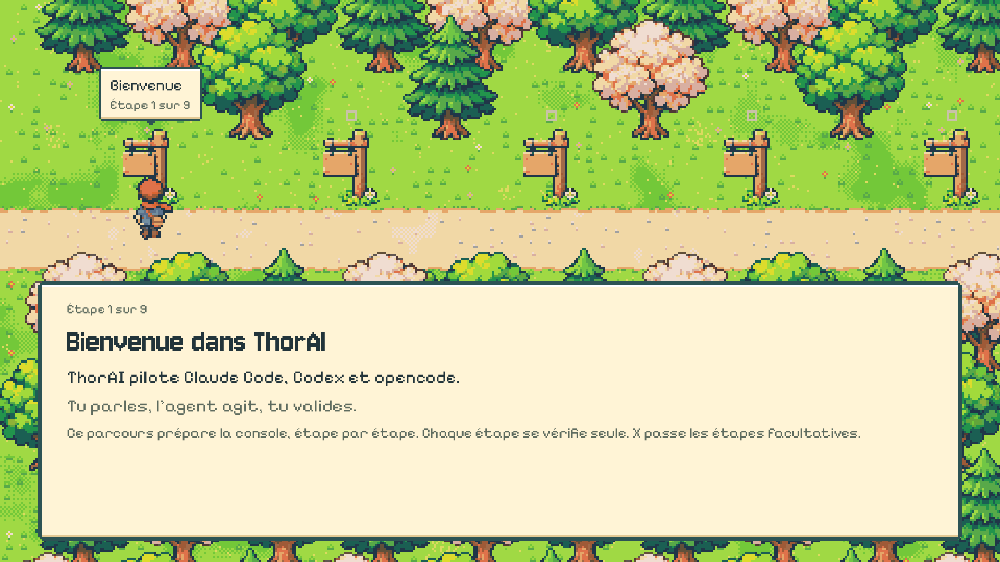
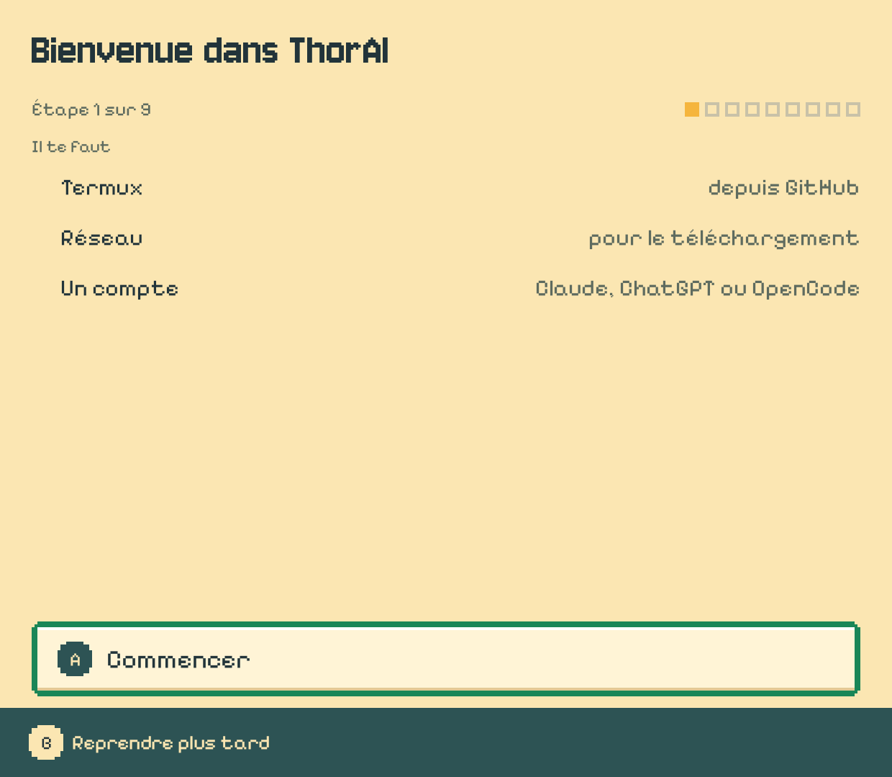
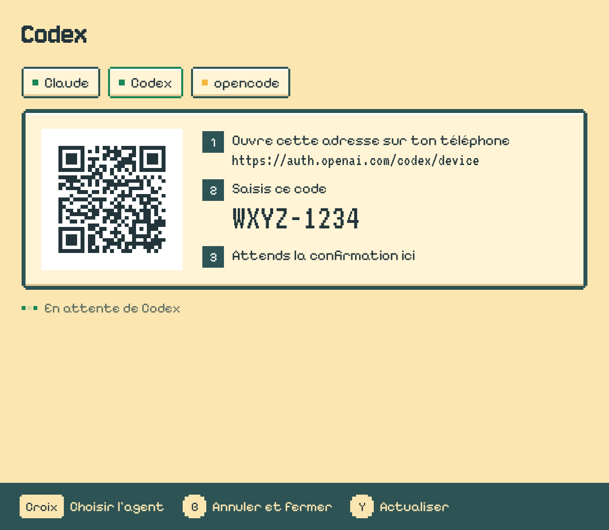

# Installer ThorAI sur une AYN Thor

Cette notice part d’une Thor neuve et va jusqu’à la première maison du hameau, pilotée à la voix. Chaque étape se termine par une vérification : ne passer à la suivante que si elle réussit.

ThorAI existait déjà, avec une interface en listes. Pour passer de cette version au hameau, aller directement à [Mettre à jour depuis l’ancienne ThorAI](#mettre-à-jour-depuis-lancienne-thorai).

Les commandes reprennent celles des scripts du dépôt, relues une à une. La séquence complète n’a pas encore été rejouée sur une console sortie de boîte : si une étape diverge, le [dépannage](#dépannage) liste les cas connus.

## Ce qu’il faut

- **Une AYN Thor** sous Android 13, reliée au Wi-Fi, avec plusieurs gigaoctets libres : Debian, Node et les agents, plus 1,2 Go pour le modèle de voix.
- **Un compte pour au moins un agent** : un abonnement Claude qui inclut Claude Code, un compte ChatGPT pour Codex, ou une clé OpenCode Go pour opencode.
- **Un téléphone**, pour valider la connexion des agents.
- **Pour le parcours USB seulement, un Mac** avec un câble USB-C. Il construit l’app et pousse les scripts sur la console. Les scripts sont écrits pour macOS ; un Linux avec bash devrait convenir, mais n’a pas été essayé.

Il y a deux chemins :

- [sans Mac](#sans-mac--installation-sur-la-console) : tout se fait sur la console, avec l’APK signé des releases ;
- [depuis un Mac, par USB](#depuis-un-mac-par-usb) : pour construire l’app soi-même.

Les deux finissent par le [parcours d’accueil](#le-parcours-daccueil) de ThorAI.

Les commandes se tapent dans trois terminaux. Chaque bloc indique le sien :

| Terminal | Où |
| --- | --- |
| **Mac** | Le terminal du Mac, à la racine du dépôt cloné. |
| **Termux** | L’appli Termux, sur la console. |
| **Debian** | La Debian, ouverte depuis Termux, en `root` ou en `dev` selon l’étape. |

## Sans Mac : installation sur la console

1. Installer Termux depuis ses [releases officielles](https://github.com/termux/termux-app/releases), puis l’ouvrir et attendre la fin de sa préparation. Le chemin sans Mac n’utilise pas `run-as` ; seuls les scripts USB du Mac exigent la variante GitHub *debug*. Garder la même provenance de Termux lors des mises à jour.
2. Dans **Termux**, cloner le dépôt et lancer l’installeur :

   ```sh
   pkg update && pkg install git
   git clone https://github.com/DabiK/thorai.git
   cd thorai && bash thor/install-on-device.sh
   ```

   Le dépôt doit être accessible au téléchargement (public, ou avec votre propre accès). L’installeur prépare Debian 13, Node, Claude Code, Codex et opencode aux versions éprouvées, le pont et l’accès des agents à Android. Il ne lance aucun agent et ne démarre rien au boot. On peut le relancer après une interruption ou une mise à jour : projets, connexions, clé adb et consignes hors des blocs Régie sont gardés.

   Le parcours d’accueil de ThorAI donne les mêmes commandes : à l’étape « Termux et Debian », **Y** les copie et ouvre Termux sur l’écran du bas.
3. Télécharger l’APK et son fichier `.sha256` dans les [releases de ThorAI](https://github.com/DabiK/thorai/releases). Pour vérifier le téléchargement, autoriser une fois `termux-setup-storage` dans Termux, puis :

   ```sh
   cd ~/storage/downloads && sha256sum -c thorai-<version>.apk.sha256
   ```

   La commande doit répondre `OK`. Ouvrir ensuite l’APK depuis le gestionnaire de fichiers Android, et autoriser cette source si Android le demande.
4. Ouvrir ThorAI : le [parcours d’accueil](#le-parcours-daccueil) s’ouvre et guide la suite.

**Vérification** : le parcours d’accueil s’ouvre sur « Bienvenue dans ThorAI », et l’étape « Pont » passe au vert une fois les commandes Termux autorisées.

## Le parcours d’accueil

Au premier lancement, ThorAI ouvre « Préparer la console ». Le coursier suit une route jalonnée de panneaux, un par étape ; une case au-dessus de chaque panneau dit où on en est. En haut, l’explication de l’étape et ses commandes. En bas, le carnet : l’état vérifié sur la console, l’action de **A** dans un grand cadre, puis **B**, **X** et **Y**.

| L’explication, en haut | L’état et l’action, en bas |
| --- | --- |
|  |  |

Les gestes :

- **A** fait l’action de l’étape : demander une autorisation, ouvrir le bon écran d’Android, télécharger, continuer ;
- **B** revient à l’étape précédente ; sur la bienvenue, il referme le parcours ;
- **X** passe une étape facultative ;
- **Y** copie les commandes de l’étape et ouvre Termux sur l’écran du bas, ou ouvre les infos de l’appli ;
- « Reprendre plus tard », en haut du carnet, referme le parcours à toute étape.

Chaque étape se vérifie seule, toutes les secondes, et passe au vert quand c’est fait. **ThorAI n’accorde rien à votre place** : elle ouvre la demande d’Android ou le bon écran des réglages, et c’est vous qui acceptez.

| Étape | Ce que vous faites | Ce qui la met au vert |
| --- | --- | --- |
| 1. Bienvenue | **A** « Commencer ». | — |
| 2. Termux et Debian | Installer Termux, puis lancer l’installeur (**Y** copie les commandes). Sans Termux, **A** « Ouvrir la page de Termux ». | Termux installé. La Debian se prouve à l’étape suivante. |
| 3. Pont | **A** « Autoriser les commandes Termux », puis accepter. ThorAI confie alors sa clé au pont. | « Pont : Joignable ». |
| 4. Voix | **A** « Autoriser le micro », puis **A** « Télécharger le modèle » (environ 490 Mo, 1,2 Go libres). Le téléchargement continue si l’on avance. | Micro autorisé et modèle installé. |
| 5. Notifications | **A** « Autoriser les notifications ». | Notifications autorisées. |
| 6. Mode console, facultatif | Voir [Le mode console](#le-mode-console). | « Mode console : Activé ». |
| 7. Accès à Android, facultatif | Voir [L’accès des agents à Android](#laccès-des-agents-à-android). | « Reconnexion Android : Autorisée ». |
| 8. Comptes des agents, facultatif | **A** « Connecter les agents ». Voir [Connecter les agents](#connecter-les-agents). | Au moins un agent connecté. |
| 9. Première session | **A** « Créer une session », ou **Y** « Terminer ». | — |

Une autorisation refusée pour de bon se rattrape avec **A** « Ouvrir les infos de l’appli ». Le micro et les notifications ne se passent que dans ce cas ; le pont ne se passe jamais.

Le parcours ne s’ouvre seul qu’une fois. Pour le reprendre plus tard : **Start** sur le hameau, puis « Préparer la console ». Il reprend à la première étape qui n’est pas faite. Le détail « Étape facultative restante » signale une étape facultative encore à faire.

### Le mode console

Le mode console fait marcher L2 et R2 depuis toute appli, et fait passer les messages de l’agent en carte volante par-dessus l’écran du haut. C’est un service d’accessibilité, que vous activez vous-même.

1. À l’étape « Mode console », **A** « Ouvrir Accessibilité ». Les réglages s’ouvrent sur l’écran du bas.
2. Dans **Applications téléchargées**, choisir **ThorAI, mode console**, l’activer et accepter.
3. Si Android parle de paramètre restreint : revenir dans ThorAI, **Y** « Ouvrir les infos de l’appli », puis **⋮ › Autoriser les paramètres restreints**, et recommencer.

Le service lit seulement la manette, jamais le contenu de l’écran. Il ne prend que L2 et R2, plus les boutons qu’un panneau de ThorAI attend ; le reste va à l’appli au premier plan ([ADR 19](adr/19-mode-console.md)). Pendant le parcours, il ne prend aucune touche aux autres applis.

**Vérification** : « Mode console : Activé » dans le carnet de l’étape.

### L’accès des agents à Android

Les agents voient et pilotent les deux écrans par le débogage sans fil de la console, depuis la Debian. L’association se fait une fois, avec la clé de la Debian.

1. À l’étape « Accès à Android », **A** « Ouvrir les options développeur ». Elles s’ouvrent sur l’écran du haut, à la croix. Si elles sont cachées : **Paramètres › À propos**, toucher sept fois le numéro de build.
2. Activer **Débogage sans fil**. À la question sur ce réseau, cocher **Toujours autoriser sur ce réseau**, puis **Autoriser**.
3. Toucher **Associer l’appareil avec un code d’association** et laisser la fenêtre ouverte. Elle affiche un code à 6 chiffres et une adresse `IP:port` ; seul le port compte.
4. Revenir dans ThorAI : **Y** « Copier et ouvrir Termux ». Termux s’ouvre sur l’écran du bas.
5. Dans **Termux**, coller les commandes. Elles demandent le port puis le code :

   ```sh
   proot-distro login debian --user dev \
     --bind "$HOME/projects:/home/dev/projects" \
     --bind "$HOME/.codex:/home/dev/.codex" \
     --work-dir /home/dev -- bash -lc '
   read -p "Port : " p; read -p "Code : " c
   /opt/thor-android/pair.sh "$p" "$c" &&
   adb shell pm grant app.thorai android.permission.WRITE_SECURE_SETTINGS &&
   adb shell settings put global settings_enable_monitor_phantom_procs false'
   ```

Le port d’association n’est pas le port de connexion affiché sur la page principale du débogage sans fil. Ni le code ni une clé ne se saisissent dans ThorAI.

`WRITE_SECURE_SETTINGS` permet à ThorAI de rallumer le débogage sans fil à son ouverture : Android le coupe à chaque redémarrage. La dernière ligne empêche Android de tuer les processus de fond de Termux.

**Vérification** : le script répond `THOR_ANDROID=ok`, la Debian apparaît dans **Appareils associés**, et l’étape passe à « Reconnexion Android : Autorisée ». Si le pont tournait déjà, ThorAI le rappelle et relie les agents à Android ; sinon, quitter puis rouvrir ThorAI.

Sur la console, retirer aussi Termux de l’optimisation de la batterie (Infos sur l’appli › Batterie).

## Depuis un Mac, par USB

Ce chemin remplace les étapes 1 à 3 du chemin sans Mac. Il construit l’app depuis le dépôt.

### 1. Préparer le Mac

Installer git, un JDK 21 ou 25, et le SDK Android en ligne de commande avec `platform-tools` (pour `adb`), la plateforme `android-36` et des build-tools 36. `adb` doit être dans le `PATH`.

Dans le terminal **Mac** :

```sh
git clone https://github.com/DabiK/thorai.git
cd thorai
export ANDROID_HOME=/opt/homebrew/share/android-commandlinetools  # adapter à l’emplacement du SDK
printf 'sdk.dir=%s\n' "$ANDROID_HOME" > android/local.properties
printf 'sdk.dir=%s\n' "$ANDROID_HOME" > voice/local.properties
```

Sur la console, ouvrir **Paramètres › À propos**, toucher sept fois le numéro de build, puis activer **Options pour les développeurs › Débogage USB**. Brancher le Mac et accepter sa clé sur la console. Puis, dans le terminal **Mac** :

```sh
adb devices
export THOR_SERIAL=XXXXXXXX  # remplacer par la série affichée par adb devices
```

**Les scripts sélectionnent l’unique appareil adb autorisé.** Avec plusieurs appareils, exporter `THOR_SERIAL` dans chaque terminal. Les commandes adb écrites ci-dessous utilisent cette variable.

**Vérification** : `adb -s "$THOR_SERIAL" get-state` répond `device`.

### 2. Termux et Debian

#### Termux, version GitHub debug

Installer **Termux depuis ses [releases GitHub](https://github.com/termux/termux-app/releases)**, fichier `…github-debug_arm64-v8a.apk`. Les scripts USB passent par `run-as com.termux`, qui exige cette variante *debug*. Ne pas mélanger avec la version F-Droid ou Google Play : les signatures diffèrent. Depuis le terminal **Mac** :

```sh
adb -s "$THOR_SERIAL" install termux-app_<version>+github-debug_arm64-v8a.apk
```

Ouvrir Termux une fois sur la console et attendre la fin de son installation initiale. Puis, dans le terminal **Mac** :

```sh
adb -s "$THOR_SERIAL" shell run-as com.termux id
adb -s "$THOR_SERIAL" shell settings put global settings_enable_monitor_phantom_procs false
```

La première commande doit afficher un `uid=`. « package not debuggable » signifie que ce Termux n’est pas la variante GitHub debug. La seconde empêche Android de tuer les processus de fond de Termux.

Sur la console, retirer aussi Termux de l’optimisation de la batterie (Infos sur l’appli › Batterie).

#### Debian

Dans **Termux** :

```sh
pkg update && pkg upgrade
pkg install proot-distro curl util-linux
mkdir -p ~/projects ~/.codex
proot-distro install --name debian debian:13
```

`curl` et `util-linux` sont souvent déjà présents ; les scripts de démarrage du pont s’en servent (`curl`, `flock`, `setsid`). Le conteneur doit s’appeler `debian`. `~/projects` recevra les projets des agents, `~/.codex` la configuration de Codex : la Debian les voit en `/home/dev/projects` et `/home/dev/.codex`.

**Vérification**, dans **Termux** :

```sh
cat "$PREFIX/var/lib/proot-distro/containers/debian/rootfs/etc/debian_version"
```

La commande affiche un numéro en 13. Les scripts attendent ce chemin exact ; s’il diffère, la version de PRoot Distro range ses conteneurs ailleurs ([documentation de PRoot Distro](https://github.com/termux/proot-distro#readme)).

### 3. Claude Code et Codex dans la Debian

Les versions ci-dessous sont celles éprouvées avec ThorAI. D’autres peuvent fonctionner ; le carnet du hameau les signale comme « version non testée ». opencode est installé avec le pont, à l’étape suivante.

#### En root, Node et Codex

Dans **Termux**, ouvrir la Debian en root :

```sh
proot-distro login debian
```

Puis, dans **Debian, en root** :

```sh
apt-get update
apt-get install -y ca-certificates curl xz-utils git jq procps python3 ripgrep
useradd --create-home --shell /bin/bash dev
mkdir -p /home/dev/projects /home/dev/.codex
chown -R dev:dev /home/dev
cd /tmp
curl -fLO https://nodejs.org/dist/v24.22.3/node-v24.22.3-linux-arm64.tar.xz
curl -fLO https://nodejs.org/dist/v24.22.3/SHASUMS256.txt
grep ' node-v24.22.3-linux-arm64.tar.xz$' SHASUMS256.txt | sha256sum -c -
```

Ne continuer que si la dernière ligne répond `OK`. Puis, toujours en root :

```sh
tar -xJf node-v24.22.3-linux-arm64.tar.xz -C /opt
ln -s /opt/node-v24.22.3-linux-arm64/bin/node /usr/local/bin/node
ln -s /opt/node-v24.22.3-linux-arm64/bin/npm /usr/local/bin/npm
ln -s /opt/node-v24.22.3-linux-arm64/bin/npx /usr/local/bin/npx
npm install --global --prefix /opt/codex-cli @openai/codex@0.167.2
ln -s /opt/codex-cli/bin/codex /usr/local/bin/codex
exit
```

Le pont cherche Codex en `/usr/local/bin/codex` et lance Node depuis la Debian. `jq` sert à l’installation de l’accès Android, `git` à la création de projets.

#### En dev, Claude Code et réglages de Codex

De retour dans **Termux**, ouvrir la Debian en `dev`, avec les mêmes montages que le pont. **C’est la commande d’entrée dans la Debian** ; elle resservira :

```sh
proot-distro login debian --user dev \
  --bind "$HOME/projects:/home/dev/projects" \
  --bind "$HOME/.codex:/home/dev/.codex" \
  --work-dir /home/dev -- bash -l
```

Dans **Debian, en dev** :

```sh
curl -fsSL https://claude.ai/install.sh | bash -s 2.1.322
printf '\nexport PATH="$HOME/.local/bin:/usr/local/bin:$PATH"\n' >> ~/.profile
export PATH="$HOME/.local/bin:/usr/local/bin:$PATH"
```

L’installeur pose Claude en `~/.local/bin/claude`, là où le pont le cherche. La ligne ajoutée à `~/.profile` le rend visible aux scripts d’installation. ([Installation de Claude Code](https://code.claude.com/docs/en/setup).)

Le sandbox Linux de Codex ne fonctionne pas sous PRoot. Sur une installation neuve, `~/.codex/config.toml` n’existe pas encore ; le créer avec ces deux réglages, toujours en **dev** :

```sh
cat >> ~/.codex/config.toml << 'EOF'
sandbox_mode = "danger-full-access"
approval_policy = "on-request"
EOF
```

Si le fichier existait déjà avec des sections `[…]`, placer plutôt ces deux lignes avant la première section. ThorAI applique ensuite le mode de validation choisi pour chaque session ([ADR 02](adr/02-pilotage-des-agents.md)).

**Vérification**, en **dev** :

```sh
node --version     # v24.22.3
codex --version    # codex-cli 0.167.2
claude --version   # 2.1.322 (Claude Code)
exit
```

### 4. Le pont, opencode et l’accès des agents à Android

Les deux scripts se lancent depuis le **Mac**, console branchée. Ils sont idempotents : on peut les relancer après une mise à jour.

```sh
thor/bridge/install.sh
thor/computer-use/install.sh
```

`thor/bridge/install.sh` installe d’abord **opencode 2.1.2** dans la Debian (build officielle `@opencode/cli-linux-arm64`, empreinte SHA-512 vérifiée). Puis il fait quatre choses :

1. il copie le pont dans la Debian (`/home/dev/.local/share/regie/bridge`) et installe ses dépendances ;
2. il crée un jeton aléatoire pour le pont ;
3. il passe `allow-external-apps=true` dans Termux, pour que ThorAI puisse démarrer le pont ;
4. il pose `regie-bridge-configure`, `regie-bridge-start`, `regie-bridge-stop`, `regie-bridge-supervise` et `regie-android-access` dans le `~/bin` de Termux.

À ce stade, il signale que l’app `app.thorai` n’est pas installée : c’est normal. Rien ne démarre au boot.

`thor/computer-use/install.sh` donne aux agents la main sur Android :

1. dans la Debian, `adb`, [mobile-mcp](https://github.com/mobile-next/mobile-mcp) 1.0.17 et les scripts de `/opt/thor-android/` ;
2. pour `dev`, les commandes `thor-screen` (écran du bas) et une cale `adb` qui garde le serveur adb sur une socket privée ;
3. des consignes globales pour les agents, dans `~/.claude/CLAUDE.md`, `~/.codex/AGENTS.md` et `~/.config/opencode/AGENTS.md`, entre deux marqueurs ;
4. le serveur MCP `thor_android` déclaré aux agents, et ses outils autorisés sans validation.

Le reste des fichiers des agents est conservé. Le détail et la façon de retirer cet accès sont dans le [guide de l’accès Android](../thor/computer-use/README.md).

**Vérification** : le premier script finit par « Installé. » après les étapes 1/4 à 4/4, le second après les étapes 1/5 à 5/5. Pour essayer le pont à la main, dans **Termux** : `~/bin/regie-bridge-start` répond « Pont démarré sur 127.0.0.1:47600. », puis `~/bin/regie-bridge-stop` répond « Pont arrêté. ».

### 5. L’application

Dans le terminal **Mac** :

```sh
scripts/thor-install.sh            # APK de debug
scripts/thor-install.sh --release  # ou APK signé avec votre clé de release
```

Le script construit l’APK, installe `app.thorai` par-dessus l’éventuelle version en place, puis l’ouvre. Il n’installe ni ne désinstalle rien d’autre. Les deux variantes ne sont pas signées par la même clé : voir [la signature](#la-signature-debug-ou-release) avant de passer de l’une à l’autre.

- **Debug** : signé par la clé de debug du SDK Android de ce Mac.
- **Release** : signé par la clé décrite dans `~/.config/regie/release.properties` (ou le fichier désigné par `REGIE_RELEASE_CONFIG`), hors du dépôt. Sans ce fichier, le script s’arrête sur « Configuration de signature release absente. ». `scripts/release.sh <version> --build-only` crée la clé si elle n’existe pas, construit et vérifie l’APK signé ; sauvegarder alors la clé et sa configuration.

Il n’y a plus de jeton à copier : à l’étape « Pont » du parcours, ThorAI crée son propre jeton et le confie au pont par Termux, sous le nom de son paquet ([ADR 22](adr/22-plusieurs-apps-sur-le-pont.md)).

**Vérification** : ThorAI s’ouvre sur le parcours d’accueil, et l’étape « Pont » passe au vert.

### 6. Associer le débogage sans fil depuis le Mac

Le parcours d’accueil fait cette association depuis Termux ([L’accès des agents à Android](#laccès-des-agents-à-android)). Console branchée, on peut aussi la faire depuis le Mac :

1. Sur la console, ouvrir **Paramètres › Options pour les développeurs › Débogage sans fil** et l’activer. Cocher **Toujours autoriser sur ce réseau**, puis **Autoriser**.
2. Toucher **Associer l’appareil avec un code d’association** et laisser la fenêtre ouverte.
3. Dans le terminal **Mac**, avec le port et le code de cette fenêtre :

   ```sh
   thor/computer-use/pair-from-mac.sh <port> <code>
   adb -s "$THOR_SERIAL" shell pm grant app.thorai android.permission.WRITE_SECURE_SETTINGS
   ```

Ne pas utiliser `adb pair` depuis le Mac à la place : c’est la clé du Mac qui serait associée.

**Vérification** : le script répond `THOR_ANDROID=ok serial=… via=sans-fil`, la Debian apparaît dans **Appareils associés**, et l’étape « Accès à Android » du parcours passe au vert.

Le reste se fait dans le [parcours d’accueil](#le-parcours-daccueil).

## Connecter les agents

Les connexions restent dans les fichiers des agents, dans la Debian. Aucun jeton ne passe par ThorAI ni par ses journaux ([ADR 18](adr/18-connexion-des-agents.md)).

L’étape « Comptes des agents » du parcours ouvre l’écran **Agents**. Plus tard, sur le hameau, **B** l’ouvre aussi, comme **Start › Agents**. La croix choisit l’agent, **Y** « Actualiser » relit l’état.

### Codex, par code d’appareil

1. Choisir Codex, puis **A** « Connecter ». L’écran affiche une adresse, un code et un QR code.
2. Scanner le QR code avec le téléphone, ou ouvrir l’adresse, et saisir le code.
3. Revenir à la console et attendre « Connecté ».



Si le site refuse, activer la connexion par code d’appareil dans les réglages de sécurité du compte ChatGPT ; sur un compte d’organisation, c’est l’administrateur qui l’autorise.

### Claude, dans Termux

Claude Code ne propose pas de code d’appareil : sa connexion se fait dans Termux. Choisir Claude, puis **A** « Marche à suivre » : ThorAI rappelle ces étapes. Dans **Termux**, ouvrir la Debian en **dev** :

```sh
proot-distro login debian --user dev \
  --bind "$HOME/projects:/home/dev/projects" \
  --bind "$HOME/.codex:/home/dev/.codex" \
  --work-dir /home/dev -- bash -l
claude auth login
```

Ouvrir l’adresse affichée sur le téléphone, se connecter, puis recopier dans Termux le code que le navigateur affiche. Revenir dans ThorAI, choisir Claude, puis **Y** « Actualiser ».

### opencode, avec une clé OpenCode Go

Choisir **opencode**, saisir la clé OpenCode Go dans le champ masqué, puis **A** ou « Enregistrer la clé ». ThorAI transmet la saisie au pont ; seul opencode la stocke. Ne jamais coller une clé dans un script, un terminal partagé ou un rapport.

OpenCode Go est facultatif. Les autres fournisseurs se configurent par `opencode auth login` dans la Debian, puis sont proposés dans les modèles.

Un changement de compte est refusé tant que l’agent tourne : **Start › Quitter**, rouvrir ThorAI, puis recommencer. C’est aussi le cas si une découverte d’options a déjà démarré opencode.

**Vérification** : dans **Agents**, chaque agent utilisé affiche « Connecté ».

## Première session

1. **Bâtir une maison.** Sur le hameau, **X** ouvre la fiche « Nouvelle session » : agent, projet, branche, mode, modèle, réflexion et consigne. La croix passe d’un champ à l’autre. Pour un premier essai, aller sur **Projet**, puis ← → jusqu’au bout : « Nouveau projet : créer un dépôt vide ». ThorAI crée un dépôt Git vide dans `~/projects` de Termux. **L2** dicte la consigne. **A** « Bâtir ».
2. **Suivre le chantier.** En haut, le chantier passe par ses quatre étapes : Fiche, Session créée, Agent lancé, Première réponse. À la première réponse, le coursier entre dans la maison.
3. **Parler.** Dans la maison, maintenir **L2**, dire une consigne, relâcher. La transcription s’écrit sur l’écran du bas. **A** l’envoie, **B** l’efface. Si le modèle de voix n’a pas été téléchargé pendant le parcours, la première dictée le télécharge : il faut du réseau et 1,2 Go libres. Ensuite, la transcription marche hors ligne.
4. **Suivre et régler.** En haut, l’habitant travaille et sa dernière réplique s’affiche. En bas, le fil de la session, puis les réglages de l’agent : **Droite** les passe en modification, la croix choisit et change, **A** applique. **B** ressort sur le hameau.
5. **Piloter la console.** Sur le hameau, **Y** ouvre la session « console », proposée en mode « Tout autoriser ». **A** la crée. Demander par exemple « ouvre le navigateur sur wikipedia.org » : Chrome s’ouvre en haut, ThorAI reste en bas.
6. **Quitter.** **Start › Quitter** arrête le pont et les sessions, avec une confirmation si une session travaille encore. Passer à une autre appli, au contraire, laisse tourner les sessions.

**Vérification** : la maison de la session est dans le hameau, avec la bulle de son état, et l’agent a répondu dans le fil.

Le [README](../README.md#les-commandes-de-la-manette) liste toutes les commandes de la manette.

## Mettre à jour

1. **Start › Quitter** dans ThorAI.
2. Mettre à jour la console :
   - sans Mac, dans **Termux** : `cd thorai && git pull && bash thor/install-on-device.sh` (le dossier s’appelle `regie` sur une console installée avant que le dépôt prenne le nom de ThorAI) ;
   - depuis le **Mac** : `git pull`, puis les scripts des parties qui ont changé : `thor/bridge/install.sh` pour le pont et opencode, `thor/computer-use/install.sh` pour l’accès Android.
3. Installer la nouvelle app par-dessus l’ancienne, signée par la même clé : APK de la release, ou `scripts/thor-install.sh` (avec `--release` si l’app en place est une release).
4. Rouvrir ThorAI.

Une nouvelle association n’est pas nécessaire. Après un changement de consignes, créer une nouvelle session : les sessions ouvertes gardent les anciennes.

## Mettre à jour depuis l’ancienne ThorAI

La nouvelle ThorAI remplace l’interface en listes par le hameau. Le paquet reste `app.thorai`. Le pont, les agents, les sessions, les projets et les comptes ne changent pas.

### Par-dessus, avec la même clé

Si la nouvelle app est signée par la même clé que l’ancienne, elle s’installe par-dessus et garde tout.

1. Dans l’ancienne ThorAI, choisir **Quitter**.
2. Mettre à jour la console, comme dans [Mettre à jour](#mettre-à-jour), étape 2.
3. Installer la nouvelle app :
   - une release sur une release : ouvrir le nouvel APK, Android propose la mise à jour ;
   - depuis le Mac : `scripts/thor-install.sh --release` sur une release, avec la même configuration de signature ; `scripts/thor-install.sh` sur un debug construit par le même Mac.
4. Ouvrir ThorAI. L’écran titre s’affiche ; « Continuer » mène au hameau, qui se construit à partir des sessions existantes : une maison par session, une rue par projet.

Restent en place :

- les autorisations : commandes Termux, micro, notifications, `WRITE_SECURE_SETTINGS` ;
- le mode console, s’il était activé dans Accessibilité ;
- les réglages de la voix, les clés ElevenLabs et Mistral, et le modèle de voix déjà téléchargé ;
- le jeton du pont ;
- le parcours d’accueil, s’il avait été terminé ou refermé : il ne se rouvre pas seul. **Start › Préparer la console** le reprend.

Android refuse aussi d’installer un numéro de version plus bas que celui en place (`INSTALL_FAILED_VERSION_DOWNGRADE` avec adb). `scripts/thor-install.sh` construit le numéro par défaut de `android/app/build.gradle.kts` ; par-dessus une release publiée plus récente, installer plutôt l’APK de la release.

### La signature, debug ou release

Android n’installe une app par-dessus une autre que si les deux sont signées par la même clé. Il y a deux clés :

| APK | Signé par |
| --- | --- |
| Releases GitHub, `scripts/release.sh`, `scripts/thor-install.sh --release` | La clé de release, hors du dépôt, décrite par `~/.config/regie/release.properties` |
| `scripts/thor-install.sh` | La clé de debug du SDK Android du Mac qui construit |

Deux APK de debug construits sur deux Mac différents n’ont donc pas la même clé non plus.

Si la clé diffère, Android refuse la mise à jour : le paquet est en conflit avec celui installé (`INSTALL_FAILED_UPDATE_INCOMPATIBLE` avec adb). Il faut alors désinstaller l’ancienne ThorAI d’abord.

### Avec une autre clé : désinstaller d’abord

1. Dans l’ancienne ThorAI, choisir **Quitter**.
2. Désinstaller ThorAI : **Paramètres › Applis › ThorAI › Désinstaller**, ou depuis le **Mac** :

   ```sh
   adb -s "$THOR_SERIAL" uninstall app.thorai
   ```

3. Mettre à jour la console, comme dans [Mettre à jour](#mettre-à-jour), étape 2.
4. Installer la nouvelle app, puis l’ouvrir : le parcours d’accueil s’ouvre, comme au premier lancement.

**Ce qui se perd**, parce que c’est rangé dans l’app :

- les réglages de la voix et les clés ElevenLabs et Mistral, à saisir de nouveau ;
- le modèle de voix, environ 490 Mo à télécharger de nouveau ;
- le jeton du pont : la nouvelle app en crée un autre à l’étape « Pont » ;
- le souvenir du parcours d’accueil, qui se rouvre ;
- la disposition du hameau, qui est reconstruite.

**Ce qui reste**, parce que c’est rangé dans Termux et la Debian : les projets, les sessions et leur historique, les comptes de Claude, Codex et opencode, la clé OpenCode Go et l’association du débogage sans fil.

**Ce qu’il faut accorder de nouveau**, en suivant le parcours :

- les commandes Termux (étape « Pont »), le micro (étape « Voix ») et les notifications ;
- le mode console : le réactiver dans Accessibilité. Android peut redemander d’autoriser les paramètres restreints ;
- `WRITE_SECURE_SETTINGS` : refaire l’étape « Accès à Android » avec un nouveau code d’association, ou, depuis le **Mac** :

  ```sh
  adb -s "$THOR_SERIAL" shell pm grant app.thorai android.permission.WRITE_SECURE_SETTINGS
  ```

### Les anciennes apps d’essai

- **Régie** (`app.regie`), le nom d’avant ThorAI, est un autre paquet : la désinstaller une fois ThorAI reliée au pont.
- **ThorAI jeu** (`app.thorai.jeu`), la version d’essai du hameau installée à côté de ThorAI, est aussi un autre paquet : la désinstaller. Son jeton reste accepté par le pont tant que son fichier existe. Pour le retirer, dans **Termux** :

  ```sh
  rm "$PREFIX/var/lib/proot-distro/containers/debian/rootfs/home/dev/.config/regie/bridge-tokens/app.thorai.jeu"
  ```

N’activer qu’un mode console à la fois dans Accessibilité : ceux de ces apps lisent la même manette.

## Désinstaller

Depuis le **Mac** :

```sh
thor/computer-use/uninstall.sh
adb -s "$THOR_SERIAL" uninstall app.thorai
```

Le premier retire l’accès Android, ses déclarations et ses consignes pour Claude et Codex ; il garde la clé adb de la Debian, sauf avec `--oublier-association`. Il ne modifie pas la configuration d’opencode : y retirer à la main `thor_android` de `mcp.servers`. Le pont n’a pas de script de désinstallation : ses fichiers sont `~/bin/regie-*` dans Termux, `/home/dev/.local/share/regie/` et `/home/dev/.config/regie/` dans la Debian. Sur la console, couper aussi le débogage sans fil et retirer la Debian des **Appareils associés**.

## Dépannage

### Messages de ThorAI

| Message | Que faire |
| --- | --- |
| « Clé du pont absente » ou « Clé du pont refusée » | Vérifier que les commandes Termux sont autorisées, puis rouvrir ThorAI : elle reconfigure le pont. |
| « Termux ne répond pas » | Dans **Termux**, relancer `bash thor/install-on-device.sh` depuis le dépôt ; ou, depuis le **Mac**, `thor/bridge/install.sh`. Puis rouvrir ThorAI. Vérifier que Termux a été ouvert au moins une fois. |
| « Autorise les commandes Termux. » | Sur la console : **Infos sur l’appli ThorAI › Autorisations › Autorisations supplémentaires**, activer « Run commands in Termux environment ». |
| « Reconnexion Android : À autoriser » dans le parcours | Refaire l’[accès des agents à Android](#laccès-des-agents-à-android), ou la commande `pm grant` depuis le Mac. |
| « version non testée » dans le carnet | Claude Code s’est mis à jour seul. Cela peut marcher ; pour revenir à la version éprouvée, relancer son installeur avec `2.1.322` ([mises à jour de Claude Code](https://code.claude.com/docs/en/setup#disable-auto-updates)). |
| « Rien entendu. Aucun message envoyé. » | La dictée était vide : maintenir L2 pendant toute la phrase. |
| « Action non confirmée… » dans Agents | Une session de cet agent tourne : **Start › Quitter**, rouvrir ThorAI, recommencer. |

### Autres problèmes

- **`run-as: package not debuggable`** : Termux n’est pas la variante GitHub debug, exigée par les scripts du Mac. La remplacer efface les données de Termux, donc la Debian : reprendre au chemin USB, étape 2, ou passer au chemin sans Mac.
- **Android refuse d’installer la nouvelle ThorAI.** La clé ou le numéro de version diffère : voir [Mettre à jour depuis l’ancienne ThorAI](#mettre-à-jour-depuis-lancienne-thorai).
- **Les agents ne voient pas Android.** Le journal du pont le dit. Dans **Termux** :

  ```sh
  grep android-access ~/.local/state/thor/regie-bridge.log | tail -n 5
  ```

  `raison=non-connecte` : le débogage sans fil est coupé, ou la console est sur un autre réseau Wi-Fi. Avec `WRITE_SECURE_SETTINGS`, ThorAI le rallume à son ouverture ; sinon, le rallumer à la main. L’association reste valable. Si elle a été perdue, refaire l’[accès des agents à Android](#laccès-des-agents-à-android). `raison=adb-absent` ou `serveur-adb` : relancer l’installeur (`bash thor/install-on-device.sh` dans Termux, ou `thor/computer-use/install.sh` depuis le Mac).
- **Le pont ne démarre pas, ou s’arrête.** Lire la fin de `~/.local/state/thor/regie-bridge.log` dans Termux. Après cinq plantages en deux minutes, le superviseur abandonne : corriger la cause, puis rouvrir ThorAI.
- **L2 ne fait rien dans une autre appli.** Vérifier le [mode console](#le-mode-console). Le service ne prend rien tant que ThorAI n’est pas reliée au pont, ni pendant **Quitter**.
- **La dictée reste muette.** Vérifier le micro dans **Start › Réglages**, puis le réseau et l’espace libre pour le premier téléchargement du modèle.
- **L’écran du bas de ThorAI a disparu.** Rouvrir ThorAI depuis le lanceur : l’écran du bas revient.
- **Android ferme Termux en arrière-plan.** Revoir l’exemption de batterie et le réglage des processus fantômes. Une mise à jour système peut les annuler.
- **Codex refuse la connexion par code.** Activer l’option dans les réglages de sécurité du compte ChatGPT, puis relancer avec **A**.

Pour aller plus loin : la [fiche de la console](thor.md), le [guide de l’accès Android](../thor/computer-use/README.md) et le [protocole du pont](protocole-pont.md).
